# Hewn Manual

Hewn is a plugin for Godot 4.7 that lets you create and edit meshes and game levels right in the Godot editor.

## Installation

1. Download the [latest release](https://github.com/haker2377/hewn/releases) or [build the plugin from source](#building).
2. Copy the `addons` folder into the root folder of your project.
3. Enable the plugin in Project -> Project Settings -> Plugins.

## Building

```
git clone https://github.com/godotengine/godot-cpp
python -m pip install scons
scons platform=windows target=editor     # or linux / macos
```

The built library goes to `project/addons/hewn/bin/`.

# Usage

## Creating Objects

### Add Menu
**Key:** Shift+A

A menu of everything that can be added to the scene: meshes, curves, lights, a camera, sounds, pictures, decals,
cutters, physics. The "+" button on the Hewn toolbar opens the same menu.

With "Create at 3D Cursor" on in the menu, the object appears at the 3D cursor with its default size. With it off, the
shape is drawn with the mouse.


### Drawing a Shape

The first click places the first corner of the base, the second click the opposite corner, the third the height. You
can also drag. For round shapes the first click places the center.

- Shift on the first click - a base at an angle: the first side gives the direction.
- Ctrl before the first click - draw on the extension of the plane of the face under the mouse.
- Alt - draw on the plane of the previous shape.
- Q / E or R - turn a shape that has a direction (stairs, door, prism, wedge).
- The height of some shapes can be typed in.
- Enter instead of drawing - a shape of the default size at the 3D cursor.

After it is made, the shape's parameter panel opens at the bottom left. It opens again when the shape is selected, as
long as its geometry has not been changed in edit mode.

A shape drawn in edit mode is added to the mesh being edited.

### Shapes

- **Cube**
- **Plane**
- **Cylinder**
- **Cone**
- **Sphere**
- **Icosphere**
- **Torus**
- **Pipe**
- **Prism**
- **Stairs**
- **Arch**
- **Door**
- **Capsule**
- **Disc**
- **Wedge**
- **Column**


#### Box


**Key:** B


With "Room" on the box is hollow. Its floor and ceiling: none, solid (as thick as the walls) or flat (one face, facing in).

#### Plane


A plane through two points.

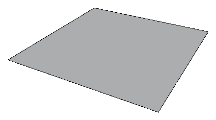

#### Cylinder


#### Cone


#### Sphere


#### Icosphere


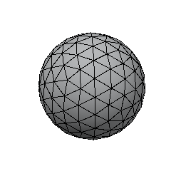

#### Torus


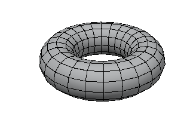

#### Pipe


#### Prism


#### Stairs


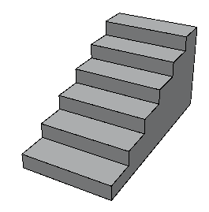

#### Arch


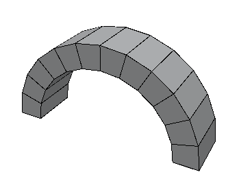

#### Capsule


#### Disc


#### Wedge


#### Wall


A wall along a line. Clicks place the corners; Enter, RMB or a double click - done; Backspace removes the last corner.


#### Column


#### Sweep


A profile along a line: railings, curbs, pipes, cornices. Drawn like a wall.

The "In View" button of the parameter panel shows the profile's points on the shape: drag, add and remove them. The
same for a column, a door, an arch, a wedge and a roof.


#### Path Stairs

Stairs along a line: flights on the segments, landings at the turns. Drawn like a wall.

The mouse wheel while drawing sets the steps of each flight. "Corner Radius" rounds the turns.


#### Poly Shape


An outline of points with a height. Clicks place the points, a click on the first point or Enter closes the outline,
then the mouse sets the height.

After it is made, its points can be changed with "Edit Base Points" in the parameter panel: drag a point to move it,
click a point to delete it, click an edge to add one.


#### Rock


A ball pushed in and out by a noise, cut flat here and there. Another seed, another rock.


#### Text


Solid letters of a font. Placed with a click; the text, the font, the size and the depth are in the parameter panel.


#### Roof


A roof over an outline: hip, gable, shed or flat. Drawn with three clicks like a box: two corners and the ridge's
height. The "Curve" button sets the slopes' shape. One roof over an L or a T outline joins its slopes itself.


## Modes

The modes are switched on the Hewn toolbar.


### Edit Mode
**Key:** Tab

Turns editing of the vertices, edges and faces of the selected meshes on and off.

### Vertices, Edges, Faces
  \
**Keys:** 1 / 2 / 3

What is selected in edit mode. Shift+1 / 2 / 3 or Shift+click on a mode button turns on several at once.

## Selection

### Select
**Keys:** LMB

Shift+click adds to the selection or takes away from it.

### Loop
**Keys:** Alt+click, double click

Selects a loop of edges or faces.


### Ring
**Key:** Ctrl+Alt+click

Selects a ring of edges or faces.


### Shortest Path
**Keys:** Ctrl+click, Ctrl+Shift+click

Ctrl+click selects the elements between the selected one and the one clicked.


Ctrl+Shift+click selects all the shortest paths between them: on a grid, the whole rectangle.

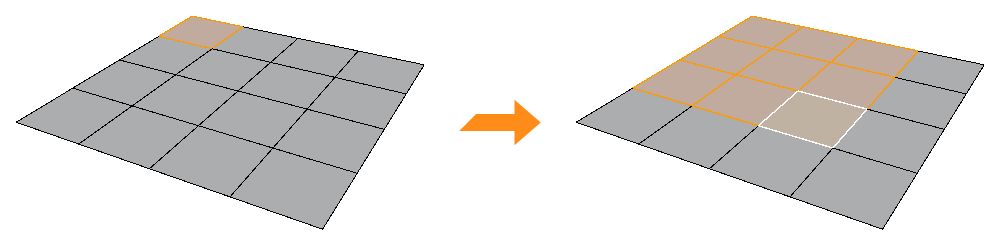

### All / None / Invert
**Keys:** A / Alt+A / Ctrl+I


### Grow / Shrink
**Keys:** Ctrl+= / Ctrl+-

Adds the neighboring elements to the selection or takes away the outer ones.


### Linked
**Keys:** L / Ctrl+L

L selects the connected part under the mouse, Ctrl+L the part connected to the selection.


### Border

Selects the open edges of the mesh: edges with only one face.


### Checker Deselect

Deselects every other element.

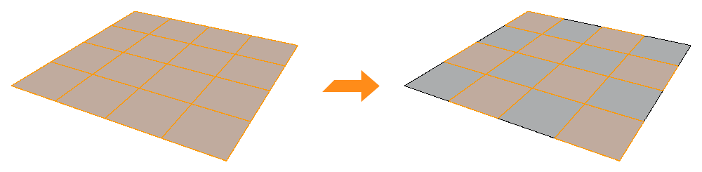

### Same Material

Selects the faces with the same material.


### Same Normal

Selects the faces facing the same way.

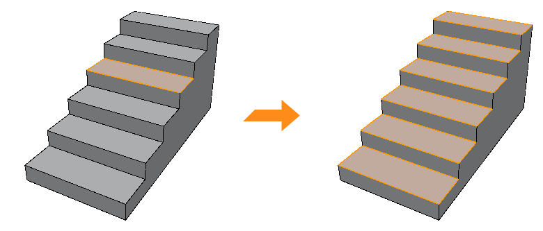

### Invalid UVs

Selects the faces whose UVs have no area.

### Inner Faces

Selects the faces no one can see: inside the mesh's own solid (merged objects that overlap or touch).

### Hide / Reveal
**Keys:** H / Shift+H / Alt+H

Hides the selected faces, hides the other faces, or shows everything again. Hidden faces are hidden only in edit mode.


### Visible Selection

The button with the eye on the toolbar. When it is on, clicks go through faces turned away from the camera, so a room
can be edited from outside.

On:

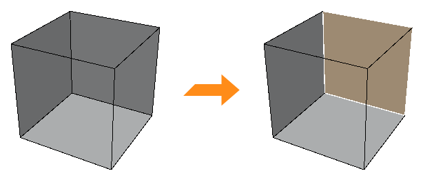

Off:

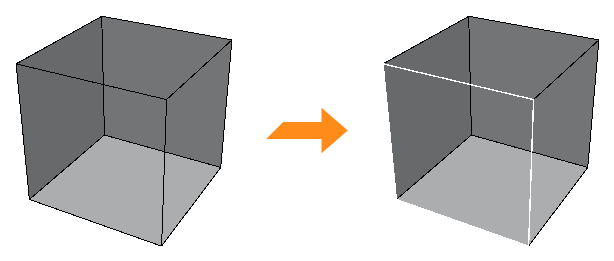

### X-Ray
**Key:** Alt+Z

The selection goes through the mesh.


## Move, Rotate, Scale

### Move / Rotate / Scale
**Keys:** G / R / S

Works on the selected elements in edit mode and on the selected objects in object mode.

- X / Y / Z - an axis, Shift+X / Y / Z - a plane, pressed again - the local axis.
- The amount can be typed in.
- Ctrl - inverts snapping.
- Shift - slows the change down for precise moves.
- LMB or Enter - apply, RMB or Esc - cancel.

### Slide
**Keys:** G G

The selected elements slide along the edges. C - keeps the elements on the line of the current edge.

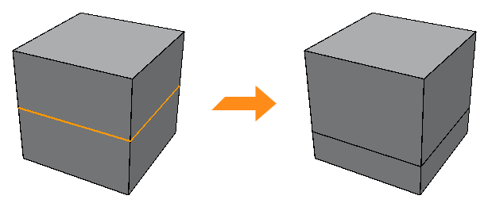

### Base Point
**Key:** B (during G / R / S and G G)

A click - the point from, a second click - the point to. Moves, rotates or scales by these points.

### Nudge with Arrows
**Keys:** arrows, Page Up / Page Down

Moves the selection by one grid step along the world axis closest to the view. With Ctrl in object mode a copy is
moved.

### Rotate with Arrows
**Keys:** Alt+arrows, Alt+Page Up / Page Down

Turns the selection by 90°.

### Gizmo
**Key:** W

Switches the gizmo: move, rotate, scale, none.

### Orientation
      

A menu on the toolbar: global, local, normal, gimbal, view, cursor, parent. "Create from Selection" adds an
orientation of your own from the selection.


### Transform Pivot
    

A menu on the toolbar: bounding box center, 3D cursor, individual origins, median point, active element.

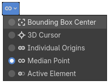

### Proportional Editing
\
**Keys:** O / Alt+O

The neighboring elements move with the selection, less the farther they are. Alt+O - only the connected ones.


### Symmetry


A button on the toolbar, its axes in the menu next to it. When vertices move, their mirror twins on the other side of
the object's axis move mirrored. New faces are not mirrored: HewnMirrorModifier does that.


### Auto Merge


A button on the toolbar. Vertices that end up next to each other after a move are merged.

## Snapping

### Snapping
**Keys:** Y, Shift+Tab

Turned on with Godot's magnet. The snapping menu on the toolbar chooses what to snap to: step, grid, vertex, edge, face,
edge center, face center.

### Grid Step
**Keys:** `[`, `]`

Makes the grid step half or twice as big. The current step is shown next to the snapping menu.

### 3D Cursor
\
**Keys:** Shift+RMB, Shift+S

Shift+RMB puts the 3D cursor on a surface. Shift+S - the cursor menu: to the selection, to the world origin, the
selection to the cursor.

## View

### Shading
      

The shader of the 3D view. "UV Stretch" shows how much the texture is stretched: blue none, red a lot.


### Overlays


## Vertices

Mesh -> Vertex menu.


### Extrude Vertices
**Key:** E

Extrudes the vertices into new edges.

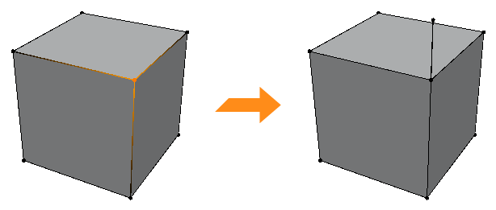

### Bevel Vertices
**Key:** Ctrl+Shift+B

Cuts the corners at the selected vertices.


### Push / Pull

Moves the vertices toward the center of the selection or away from it.

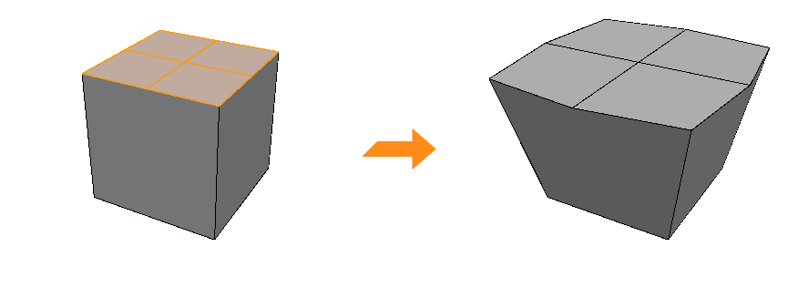

### Shrink / Fatten
**Key:** Alt+S

Moves the vertices along their normals.


### Shear

Shears the selection.


### Slide Vertices
**Key:** Shift+V

Moves a vertex along one of its edges.


### Randomize

Moves the vertices by a random distance.


### Mirror

Mirrors the selection along an axis.

### To Circle

Puts the selected vertices on a circle.


### Connect
**Key:** J

Connects the selected vertices with edges across the faces.


### Rip
**Key:** V

Rips the selection off on the side of the mouse and moves it.


### Merge
**Key:** M

Merges the selected vertices: at the center, at the cursor, at the first, at the last, by distance.


### Drop / Raise to the Surface

Each selected vertex goes straight down (up) along Y to the nearest face under (over) it.


### Merge by Distance

Merges vertices closer than the given distance.

### Vertex Crease

The vertex stays sharp when subdivided.

### Separate
**Key:** P

Moves the selection into a new mesh. It can also separate by material or by loose parts.

### Dissolve Vertices
**Key:** Ctrl+X

Removes the vertices; the faces around merge.

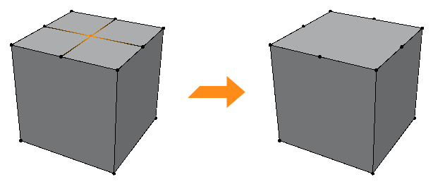

### Delete Vertices
**Keys:** X, Delete

Deletes the vertices and their faces.


## Edges

Mesh -> Edge menu.


### Extrude Edges
**Key:** E

Extrudes the edges into new faces.


### Bevel Edges
**Key:** Ctrl+B

Cuts the edges off. The wheel or +/- changes the number of segments.


### Bridge Edge Loops

Joins two loops of edges with faces. With several segments handles show at its ends: drag them.


### Sweep Along Edges

A sweep (a cornice) along the selected edges, outside the faces next to them. In face mode: along the border of the
selected faces.

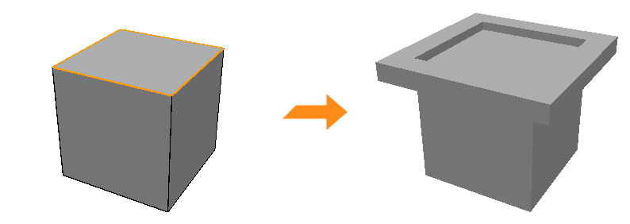

### Wall Along Edges

A wall on the selected edges: a parapet, a fence. Its height, thickness and side are set later in the shape panel.


### New Face from Edges
**Key:** F

Makes a face from the selected edges or vertices. Two vertices - an edge between them.


### Subdivide

Divides the selected edges.


### Loop Cut and Slide
\
**Key:** Ctrl+R

Cuts a loop of faces. The wheel - the number of cuts, a click - cut, then slide with the mouse, a click - apply.


### Offset Edge Slide
**Key:** Ctrl+Shift+R

Adds edges on both sides of the selected ones and moves them away from the middle.


### Connect

Joins the middles of the selected edges.


### Insert Loop

Inserts a loop through the selected edge.


### Arch Edges

Bends the selected edges into an arc. Two opposite edges of a passage's ceiling make a vault.


### Rotate Edge

Turns the edge between two faces.

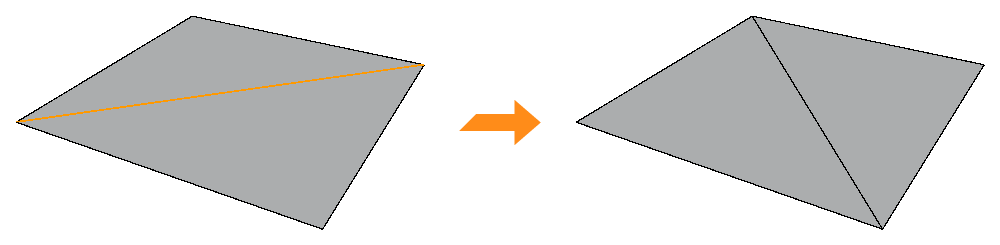

### Bevel Weight / Crease
**Key:** Shift+E (crease)

A creased edge stays sharp when subdivided.

### Mark Seam / Clear Seam

A seam stops a UV unwrap and a continued texture.

### Mark Sharp / Clear Sharp / Sharpness by Angle

At a sharp edge the normals of smooth faces are split.

### Split

Splits the mesh along the selected edges.

### Dissolve Edges
**Key:** Ctrl+X

Removes the edges; the faces on both sides merge.


### Delete Edges / Delete Edge Loops


## Faces

Mesh -> Face menu.


### Extrude Faces
**Key:** E

Extrudes the faces together. Alt+E - a menu of the other kinds.


### Extrude Along Normals

Each vertex goes along its own normal.


### Extrude Individual Faces

Each face is extruded on its own.

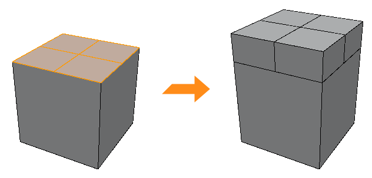

### Extrude Repeat

Extrudes the selection several times over.


### Inset
**Key:** I

Makes smaller faces inside the faces.


### Spin


Turns copies of the selection around the 3D cursor in steps.


### Poke

Splits a face into triangles with a vertex at the center.


### Bridge Faces

Joins two faces with a tunnel; the faces themselves are removed.


### To Circle

Puts the border of the selected faces on a circle.

### Subdivide

Divides the faces.


### Triangulate

Splits the faces into triangles.

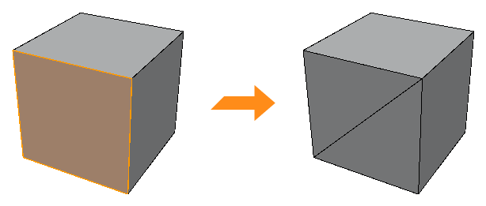

### Triangles to Quads

Merges pairs of triangles.

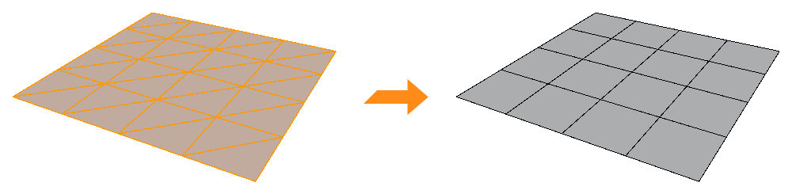

### Combine Faces

Merges the selected faces into one, the edges between them go.


### Thicken

The selected faces become a solid with a thickness.


### Fill Hole

Closes a hole with a face.


### Shade Smooth / Shade Flat

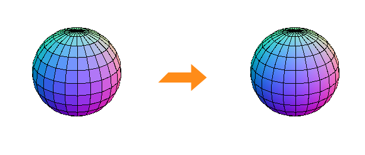

### Flip Normals

Turns the faces around.


### Double Sided

Makes the selected faces visible from both sides: a leaf, a fence. Again - one-sided again.


### Recalculate Outside / Inside
**Keys:** Shift+N / Ctrl+Shift+N

Turns all the faces outward or inward. Alt+N - the normals menu.


### Detach

Tears the selected faces off their neighbors; they stay in the same mesh.


### Duplicate
**Key:** Shift+D

Copies the selection and moves the copy.

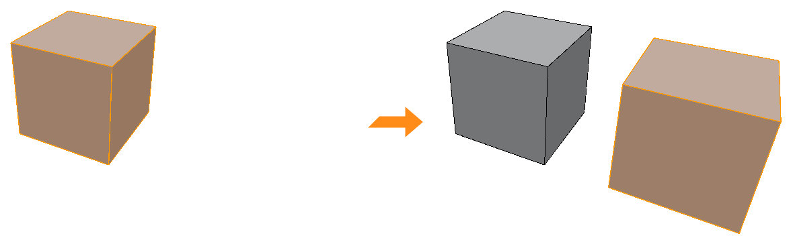

### Dissolve Faces / Limited Dissolve

Merges faces. Limited Dissolve - only those meeting at a small angle.


### Delete Faces

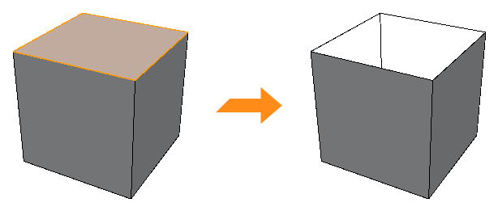

### Face Drag
**Key:** Shift+drag

In object mode moves a face along its normal; the faces around stretch. Ctrl+Shift+drag outward extrudes a new block,
inward it cuts a part off the object.

### Face Cutter


Cuts a face with lines from one of its edges.

## Tools

The tool column on the left of the viewport.


### Box Select
  

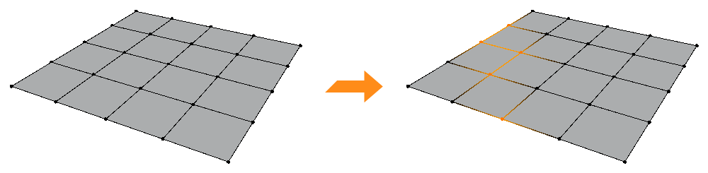

### Ruler
\
**Key:** Shift+M

A drag - a new ruler. Drag its middle - an angle. X or Delete over a ruler - delete it.


### Knife
\
**Key:** K


Clicks place points, Enter cuts. RMB ends the current cut. A - 30° angle steps, Ctrl - the middle of an edge.

### Loop Cut
\
**Key:** Ctrl+R


### Box Cut


A rectangle, a circle or a polygon on a face: a drag or clicks on the corners, then the depth. X / K / J / I / M - cut,
slice, join, intersect, make.

### Bisect


In edit mode: draw a line across the mesh; the plane through it and the view cuts the selection. In the panel: cut
only, cut and fill, remove above or below.

### Clip
\
**Key:** Alt+X


Clicks place 2 or 3 points, the plane through them cuts. Ctrl+Enter - what to keep, Enter - apply.

### Spin


A ring around the 3D cursor: drag it and the selection turns around the axis. X / Y / Z / V - the axis.

## Level Tools

### Box / Cylinder / Prism Cutter
**Key:** C (box)

Drawn like a shape and cuts its volume out of the meshes. Works on the mesh being edited, on the selected objects or on
the whole scene.


"Frame" in the cut's panel: the hole's sides and a frame round it.


### Mesh Cutter

"To Mesh Cutter" in the cutter's panel: the cutter becomes a Hewn mesh, edited like any mesh, that cuts itself out of
the meshes. One that is not closed cuts nothing.

## Objects

Object menu.

### Apply Transform

Moves the position, rotation and scale into the vertices.

### Origin to Geometry / to 3D Cursor / to Selection

Moves the object's origin; the geometry stays in place.

### Subdivide (Catmull-Clark)

Smooths the mesh by subdividing it.


### Remesh

The Object tab of the Hewn panel. Builds the selected closed meshes again, keeping their shape.
- "Voxel": faces the size of a voxel.


- "Quad": quads of the density you want.


### Collision

The Collision Only check box: the game keeps only the object's collision (an invisible wall).

The Collision group in the Inspector of a Hewn mesh. Its kinds:

- Trimesh


- Convex


- Simplified Convex


- Multiple Convex


- Box


- Capsule


- Cylinder


- Sphere


- Simplified Trimesh


### Auto Smooth

Smooth shading with sharp edges by angle.

### To Quads

Merges the triangles of the whole mesh into quads.

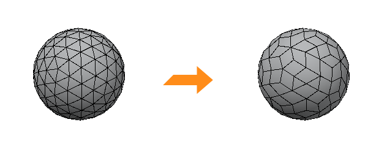

### Conform Normals / Triangulate All / Flip All Normals

### Apply Modifiers

Moves the result of the modifiers into the mesh itself. "Apply Modifier" in the Object menu - just one.

### Join Selected Objects

**Key:** Ctrl+J

### Remove Inner Faces

Removes the faces inside the body after joining objects that cross. The inside of a room stays.

### Boolean Union / Difference / Intersection
  

Union:


Difference:


Intersection:

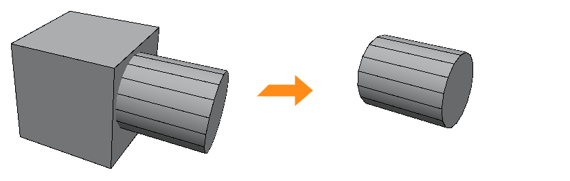

### MeshInstance3D -> Hewn

Turns a plain mesh (or a CSG shape) into a Hewn mesh.

### Bake to MeshInstance3D

Makes a plain MeshInstance3D of the selected Hewn meshes and curves.

### Export OBJ / Export glTF

Saves the selected mesh to a file (glTF or FBX), a character with its skeleton and animations.

### Object Menu
**Key:** RMB

In object mode: origin, cursor to selected, shading, normals, duplicate, delete, clear and apply transform.


### To Floor / To Ceiling

Moves the selected objects down (or up) until they touch a surface.


### Physics Placement

The selected objects fall onto what is around them. They can be dragged with the mouse; Enter - keep, Esc - cancel.

### Convert to Collision

Makes collision shapes from the selected meshes: convex, Trimesh, box, sphere, capsule, cylinder.

### Delete
**Key:** X

In object mode deletes the selected nodes.

### Isolate / Frame Selected
\
**Keys:** / , .

## Modifiers

Modifiers are added in the Inspector, in the Modifiers array (Add Element). They work top to bottom; the order is
changed by dragging.

### HewnMirrorModifier

Mirrors the mesh along axes or along the planes of another node.


### HewnSolidifyModifier

Gives the mesh a thickness.

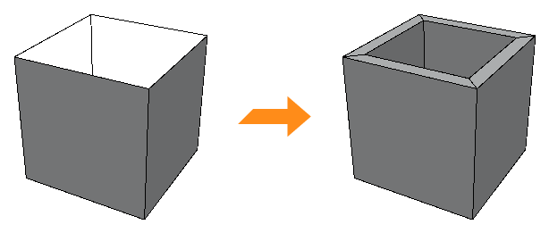

### HewnSubdivisionModifier

Smooths the mesh by subdividing it.


### HewnBooleanModifier

Joins, subtracts or intersects the mesh with other objects. The objects stay operands and can be moved.


### HewnArrayModifier

Copies of the mesh along a line, in a circle or along a curve.


### HewnCurveModifier

Bends the mesh along a curve.


### HewnRemeshModifier

Builds the mesh again: in cubes, smooth, with sharp corners, or of quads.


### HewnFractureModifier

Breaks the object into pieces. In the game the pieces are one mesh, a mesh each, or physics bodies.


### HewnSimplifyModifier

Simplifies the mesh: removes part of the triangles or merges faces lying almost in one plane.


## Textures

### Textures Dock

The pictures of the project. A click on a picture puts it on the selected faces, in object mode on the selected
objects. A picture can be dragged onto a face or an object.

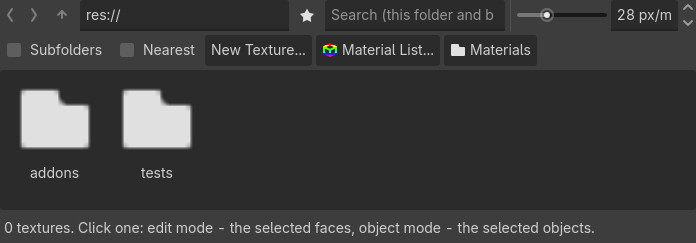

### Texture Transfer
**Keys:** Alt+click, Ctrl+Alt+click, Alt+RMB

With one face selected, Alt+click carries its texture onto other faces; the pattern continues across the edges. Dragged,
onto every face under the mouse.
Ctrl+Alt+click carries only the UVs. Alt+RMB takes the texture of the face clicked.

### Texture to Edge
**Key:** T

Puts the texture against the edge under the mouse. W / A / S / D - which side, Q - fit the height, E - fit the width,
R - scale 1. A click, Enter or T - apply, Esc - cancel.


### Texture Transform
**Key:** Shift+T

Shows a tile of the texture on the chosen face with handles: corners and sides - scale, the middle - move, the circle -
turn. G / R / S - the same with the mouse, no handles. A click off the handles or Enter - apply, Esc - cancel.


### Texture Tools
**Key:** U

A menu at the mouse with the UV tab's tools: move, rotate, scale, flip, fit, center, cube projection, continue from the
active face.

### World UVs

The texture comes from the face's place in the world: neighboring objects join without seams. Turned on in the UV tab;
"Apply World UVs" switches the selection over. "Align to Face" removes the stretch on slanted faces.

### Hotspots

An atlas (trim sheet) - a material whose picture is cut into cells. Each face gets a cell that fits it: a level gets
textured without unwrapping.

The Hotspot tab of the Hewn panel:


- "New Atlas" / "Remove" - the mesh's atlases; with several a face takes the one that fits.
- "Randomise Hotspots" - a new variant each time. "Auto Hotspot" - again after each edit.
- "Combine Faces" - neighbor faces with a small bend get one cell.
- "Choose Hotspot" (edit mode) - a cell for the selected faces.

"Edit Atlas" - the Hotspot Atlas panel:

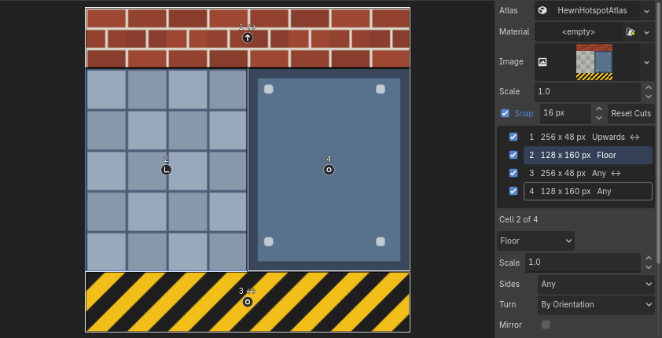

- A click cuts the picture (Ctrl - one cell), Shift+drag - a new cell, X - delete.
- The cells get a kind of faces (floor, ceiling...), repeat, rotation, weight, sizes. "Radial" - for round faces.


### Unwrap
**Key:** U

The U menu in edit mode:
- "Mark Seam" / "Clear Seam", "Seams by Angle";
- "Unwrap", "Smart UV Project", cube, cylinder, sphere and view projections;
- "Relax".


#### Quadrify

A strip of quads along the selected edge is laid out as an even grid.


### UV Lock

Faces moved in edit mode take their texture with them.

### Material Tab

The mesh's materials and the texture settings of the selected faces: filtering, transparency, vertex colors,
roughness, metallic.


### Hide the Repeats

The "Hexagons", "Random Turn" and "Color Variation" check boxes make a shader material from the material, the texture's
repeats not lined up in it.

### Tool Materials

The Clip material is not drawn in the game but has collision. It is used for invisible walls.

### Lightmap UV2

Scene tab. Builds a second unwrap for light baking.

## UV Editor

The Hewn UV dock: the UVs over the texture. UV / UV2 - in the header.


- 1 / 2 / 3 - vertices, edges, faces; click, Shift, box - select; L - island.
- G / R / S or a drag, X / Y - an axis.
- H / Shift+H / Alt+H - hide, hide the rest, show.
- U - unwraps and aligning, Ctrl+P - pack.
- The first button - the selection shared with the viewport.

## Sculpting


The mode is chosen in the menu at the start of the toolbar. LMB - a stroke, Ctrl - the other way, Shift - smoothing.
Ctrl+wheel or [ / ] - radius, Shift+wheel - strength. If something is selected, only the selection is sculpted.

The tools in the column on the left: raise / lower, smooth, flatten, grab, noise, terrace, pinch, inflate, sharp edge,
density.

### Dynamic Topology


A check box on the toolbar. Under the brush the surface is split into triangles of the right size.

## Vertex Paint


The mode is chosen in the menu at the start of the toolbar. Vertices, edges or faces are painted (1 / 2 / 3), and if
something is selected, only the selection.

### Brush


LMB paints. Ctrl+wheel - radius, Shift+wheel - strength, Ctrl+click - pick a color.

### Pencil


Paints one vertex.

### Fill


Paints the selection or a connected part.

### Select by Color

"Colors" -> "Select by Color...": the vertices whose color (or CUSTOM0-3) is within the threshold.

### Eyedropper


Takes a color. With Shift - into the second color.

### Normals


LMB makes the normals smooth, Ctrl+LMB flat.

### Colors
**Keys:** X, D


X swaps the two colors, D resets them to black and white.

### Bake Light

The Colors menu or Object -> "Bake Light to Vertex Colors". Writes the light and shadows of the scene's lights into the
vertex colors.

### Blend Material

The Material tab. Blends up to four textures by the vertex colors. A noise mask breaks up the borders, lift by paint
raises the vertices (snow).

### Scrolling Material

The Material tab: the texture moves across the faces (water, a conveyor).

## Texture Paint


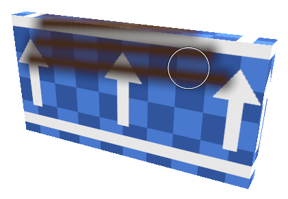

The menu at the start of the toolbar, Tab leaves. Paints on the albedo (UV1) or on the Detail layer (UV1 or UV2). With no
picture yet the first stroke makes a PNG next to the scene.

LMB - paint, Ctrl+wheel - radius, Shift+wheel - strength, Ctrl+click - eyedropper, X - swap colors.

### Draw and Erase
 \
**Keys:** B / E

Erase clears the Detail layer and brings the albedo back to how it was.

### Blur, Fill, Eyedropper
  

Fill - the UV island under the click.

### Pen and Stamp

- Pen: pressure, tilt and speed change the size and strength.
- Stamp: a picture as the brush tip.

### Stencil


A picture over the view, put onto the mesh under the brush. Alt+drag - move, Alt+Shift - scale, Alt+Ctrl - rotate.

## Pose Mode


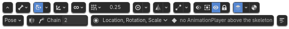


Tab on a skeleton or a character, Tab leaves.
- Click, Shift+click, box - select; [ / ] - parent / children; H / Alt+H - hide / show.
- G / R / S - as with objects; Alt+G / Alt+R / Alt+S - back to the rest pose.
- Ctrl+C / Ctrl+V - copy / paste the pose, Ctrl+Shift+V - flipped.

### X Mirror and Auto IK
 

- X Mirror: the bone of the other side (.L / .R) follows mirrored.
- Auto IK: G on a bone turns its parents.

### Keyframes
 \
**Keys:** I, Alt+I

Keys of the selected bones in the animation open in the Animation panel. Auto Keying - on each change.

### Onion Skin


The bones at the keys around: before - red, after - blue.

### Constraints

The Pose menu:
- "Add IK (Two Bones)" - on a hand or a foot, the Target and Pole markers move the chain;
- "Add Look At" - the bone looks at the Target marker;
- "Remove Constraints".

### Pose Library

The Pose menu: save a pose under a name, apply, remove.

## Rigging


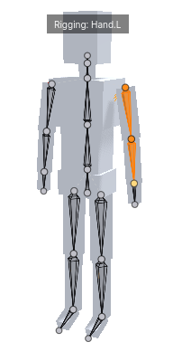

The menu at the start of the toolbar with a skeleton selected, Ctrl+Tab - Pose mode. A new skeleton: Shift+A ->
Skeleton (one bone, a human, a four-legged animal).
- The points are the bones' heads and tails; click, Shift, box - select; G / R / S - move.
- E - extrude, Shift+D - duplicate, X - delete, Ctrl+P / Alt+P - parent, F2 - rename, Ctrl+R - roll.
- "Symmetrize" - the bones of the other side.

### Binding


"Object" -> "Bind to Skeleton" with Hewn meshes and the skeleton selected: automatic weights, nearest bone or empty.

## Weight Paint


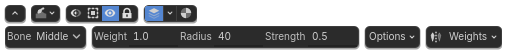


The menu at the start of the toolbar with a bound mesh, Tab leaves. The color - the weight of the chosen bone: blue - 0,
red - 1. The bone - on the toolbar or Ctrl+click.
- Draw, Add, Subtract, Smooth, Sample.
- The Weights menu: normalize, clean, mirror, automatic weights again.

## Scenes and Objects

### Scenes Dock

A click on a scene - the scene follows the mouse, releasing places it. Q / E - turn by 90°, N - along the surface
normal, R - a random turn. RMB on a scene - add it to the favorites.

### Entities

The Create tab. A light, a spotlight, a sound and objects of your own from `res://hewn_entities.json`.

### Decals and Overlays

A picture on a surface. A decal is a Godot Decal node, an overlay lies on Hewn faces. - / = while placing change the
size. The overlay's corners can be dragged with the mouse; the picture warps after them.


### Reference Image

Shift+A -> Image. A picture to trace over; not seen in the game.

### Scatter
  

Shift+A -> Scatter. Copies of meshes or scenes painted on surfaces: grass, rocks, bushes. The meshes and settings are in
the Inspector and the bottom panel. While the node is selected, its brushes are in the tool column:
- Brush: adds copies. Ctrl - erase, Shift - thin out.
- Ctrl+wheel or [ / ] - radius.

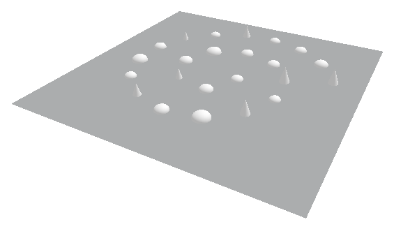

### Baking the Level

Bake Level: its options, then the file. They are kept in the project and used when the game is exported too: occluders,
merging small meshes, splitting big ones, LOD, visibility range.

Run Baked runs the level as it will be after export. F5 - unbaked.

### Roads and Bridges

Shift+A -> Curve -> Road (an overlay or a mesh on the ground) or Bridge. Any curve can have one: the Road section of
the Inspector. Pick its texture by clicking one with the curve selected. An overlay lies on the surface under the curve,
a mesh runs along the curve. A bridge starts with curbs, collision and piers.


### Curves


Shift+A -> Curve: Bezier, Circle, NURBS, Path3D, Rope. A Hewn curve is a Path3D of several splines, with a radius and a
tilt at its points. In the Inspector: extrude, bevel, fill, material, collision.

A curve is drawn point by point like a wall. Walls, sweeps and path stairs follow a curve of their own.

Tab - editing the points:
- click / Shift / box - selection, G / R / S;
- E - extrude, F - join ends, Ctrl+click - a new point, X - delete;
- V - handle type, Alt+C - cyclic, Alt+S - radius, Ctrl+T - tilt;
- RMB - a menu: subdivide, draw, smooth, simplify and more.

"Placements" (Inspector): meshes along the curve - fences, posts, lamps.

"Vertex Paint" (Inspector): the meshes under the curve are painted - a path with a blend material.

### Building

Shift+A -> Curve -> Building: a rectangle drawn with two clicks (its corners). The building (HewnBuilding3D) is made on
its outline curve: the floor, walls, windows and roof follow its points.

The floors are a list in the Inspector (bottom up), each with:
- its wall height, floor and wall thickness, whether it has a floor, walls, windows;
- windows: width, height, sill, spacing, the sides without them;
- an outline of its own (a curve under the building; empty: the one below's).

There too: the roof, a cornice, a plinth, windows in the gables and the materials.

Right click on the building -> "Building":
- "Add Floor" (a copy of the top one), "Remove Top Floor".
- "Own Outline for the Top Floor": a floor of another shape.
- "Add Courtyard": cut out of the building, with walls along it.

Tab on an outline, two neighboring points selected, right click -> "Building Side":
- "Roof: Gable / Slope / By Style".
- "No Windows" / "Windows" (the floors on this outline).
- "Add Door": an opening in the middle of the side.

Windows are set out along the outline's sides. The building's "Windows" group: a scene or a mesh in the openings and a
frame.


### Rope

Shift+A -> Curve -> Rope.


### Bake Navigation Mesh

Scene tab, or the Object menu: a NavigationMesh of the selected objects (or the whole scene), saved to a file.

### TODO Note

Shift+A -> TODO Note: a note at a place in the level (what is planned there); its text is in the panel. It is not in
the game.


## Game and Export

Scene tab.

### Bake Level

Saves a copy of the scene for the game: plain MeshInstance3D nodes, collision, occluders. The edited scene stays
editable.

### Export Scene glTF

Saves the whole scene in one file (glTF or FBX).

### Check Scene

A list of the scene's problems: faces without area, unwelded vertices, faces that are not flat and others. Most of
them can be fixed from there.

### Scene Size

Shows what takes the room in the saved scene.

## Quad View

A tab next to 2D / 3D. The 3D view at the top left, the others from the top, the front and the side.


### Block
**Key:** Shift+B

Drag a box in a 2D view; Enter makes the shape.


### Clip
**Key:** Shift+X

Draw a line; Enter cuts the selected meshes.

### Maximize View
**Key:** Shift+Z

## Settings

Editor -> Editor Settings -> Hewn.

- **Interface -> Hotkeys** - Hewn's keys on / off.
- **Interface -> Last Operation Panel** - the Last Operation panel.
- **Interface -> Quad View** - the Quad view.
- **Interface -> Toggle On Color** - the background of the header and tool buttons that are on.
- **Interface -> Wrap Cursor At Viewport Edges** - when dragging, the mouse comes out at the other side of the viewport.
- **MCP** - the MCP server (below).
- **Warnings -> Subdivide Face Limit** - how many faces a subdivision may add without asking.

The keys are changed in Editor -> Editor Settings -> Shortcuts, the "hewn" section.

### MCP Server

An assistant on this computer (an MCP client) works in the scene: nodes, Hewn shapes and operations, textures,
pictures of the view, running the game.

- **MCP -> Enabled** - on (off by default). The address: `http://127.0.0.1:7777/mcp` (HTTP), given to the MCP
  client.
- **MCP -> Port** - the port.
- **MCP -> Token** - when set, the client has to send `Authorization: Bearer <token>`.
- **MCP -> Allow Scripts** - let it run GDScript (off by default).

The server listens to this computer only and refuses requests from web pages. Each change is one Ctrl+Z step.
