# Hewn Manual

Hewn is a plugin for Godot 4.7 that lets you create and edit meshes and game levels right in the Godot editor.

## Installation

1. Download the [latest release](https://github.com/haker2377/hewn/releases) or [build the plugin from source](#building).
2. Copy the `addons` folder into the root folder of your project.
3. Enable the plugin in Project -> Project Settings -> Plugins.

## Building

```
git clone https://github.com/godotengine/godot-cpp
python -m pip install scons
scons platform=windows target=editor     # or linux / macos
```

The built library goes to `project/addons/hewn/bin/`.

# Usage

## Creating Objects

### Add Menu
**Key:** Shift+A

A menu of everything that can be added to the scene: meshes, curves, lights, a camera, sounds, pictures, decals,
cutters, physics (Area3D, a static body, a single collision shape: drawn as a box). The "+" button on the Hewn toolbar
opens the same menu. "Favorites": the scenes added to the favorites (RMB on a scene in the Scenes dock, or Godot's
FileSystem favorites); the item is there only when there are some.

With "Create at 3D Cursor" on in the menu, the object appears at the 3D cursor with its default size. With it off, the
shape is drawn with the mouse.


### Drawing a Shape

The first click places the first corner of the base, the second click the opposite corner, the third the height. You
can also drag. For round shapes the first click places the center.

- Shift on the first click - a base at an angle: the first side gives the direction.
- Ctrl before the first click - draw on the extension of the plane of the face under the mouse.
- Alt - draw on the plane of the previous shape.
- Q / E or R - turn a shape that has a direction (stairs, door, prism, wedge).
- The height of some shapes can be typed in.
- Enter instead of drawing - a shape of the default size at the 3D cursor.

After it is made, the shape's parameter panel opens at the bottom left. It opens again when the shape is selected, as
long as its geometry has not been changed in edit mode.

A shape drawn in edit mode is added to the mesh being edited.

### Shapes

- **Cube**
- **Plane**
- **Cylinder**
- **Cone**
- **Sphere**
- **Icosphere**
- **Torus**
- **Pipe**
- **Prism**
- **Stairs**
- **Arch**
- **Door**
- **Capsule**
- **Disc**
- **Wedge**
- **Column**


#### Box


**Key:** B


With "Room" on the box is hollow. Its floor and ceiling: none, solid (as thick as the walls) or flat (one face, facing in).

#### Plane


A plane through two points.


#### Cylinder


#### Cone


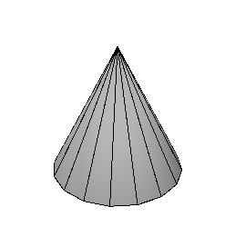

#### Sphere


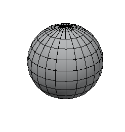

#### Icosphere


#### Torus


#### Pipe


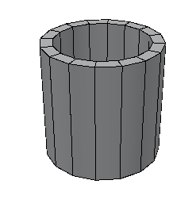

#### Prism


#### Stairs


"Step Shape": the tread's overhang and thickness. "Border Position": inside, outside or on the edge. "Ramp": a slope
beside the steps.

#### Arch


#### Capsule


#### Disc


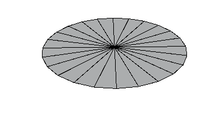

#### Wedge


#### Wall


A wall along a line. Clicks place the corners; Enter, RMB or a double click - done; Backspace removes the last corner.


#### Column


#### Sweep


A profile along a line: railings, curbs, pipes, cornices. Drawn like a wall.

"Align": "Center" on the line, "Outside" or "Inside" beside it. A path standing in a wall (a door frame) keeps the
profile out of the wall all round.

The "In View" button of the parameter panel shows the profile's points on the shape in the 3D view: drag them, a click
on the curve adds a point, Delete or X removes the selected one. The same for a column, a door, an arch, a wedge and a
roof.


#### Path Stairs

Stairs along a line: flights on the segments, landings at the turns. Drawn like a wall.

The mouse wheel while drawing sets the steps of each flight.

"Corner Radius" rounds the turns: the steps fan round, no landings. In "Edit Path Points" Ctrl+drag raises or lowers a
point. "UV Along" lays the texture the way the stairs go.


#### Poly Shape


An outline of points with a height. Clicks place the points, a click on the first point or Enter closes the outline,
then the mouse sets the height.

After it is made, its points can be changed with "Edit Base Points" in the parameter panel: drag a point to move it,
click a point to delete it, click an edge to add one.


#### Rock


A rock: a ball pushed in and out by a noise (roughness, bump size, layers), cut flat here and there (facets), flat at the
bottom, tapering and leaning. Another seed, another rock.


#### Text


Solid letters of a font. Placed with a click; the text, the font, the size and the depth are in the parameter panel.


#### Roof


A roof over an outline: hip, gable, shed or flat. Drawn with three clicks like a box: two corners and the ridge's
height. The pitch, the
overhang, the thickness; for a gable roof which sides are gables and the gable walls. The "Curve" button sets the slopes'
shape from the eaves to the ridge (a break, a mansard). One roof over an L or a T outline joins its slopes itself.
- "Height By": the pitch or the ridge's height (the pitch made to fit it).
- "Flat Top": flat above this height.
- "UV Along Slope": the texture laid along each slope.
- "Gable Eave": a little roof along the foot of each gable.
- The gables' outer faces can get their own material.
- "Edit Base Points" puts the roof on a curve: Ctrl+click adds a point, V sets a point's type.


## Modes

The modes are switched on the Hewn toolbar.


### Edit Mode
**Key:** Tab

Turns editing of the vertices, edges and faces of the selected meshes on and off.

### Vertices, Edges, Faces
  \
**Keys:** 1 / 2 / 3

What is selected in edit mode. Shift+1 / 2 / 3 or Shift+click on a mode button turns on several at once.

## Selection

### Select
**Keys:** LMB

Shift+click adds to the selection or takes away from it.

### Loop
**Keys:** Alt+click, double click

Selects a loop of edges or faces.


### Ring
**Key:** Ctrl+Alt+click

Selects a ring of edges or faces.


### Shortest Path
**Keys:** Ctrl+click, Ctrl+Shift+click

Ctrl+click selects the elements between the selected one and the one clicked.

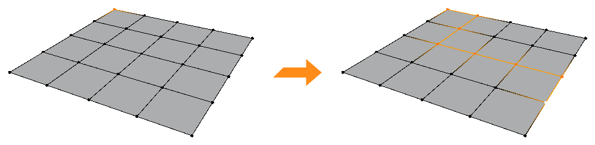

Ctrl+Shift+click selects all the shortest paths between them: on a grid, the whole rectangle.


### All / None / Invert
**Keys:** A / Alt+A / Ctrl+I


### Grow / Shrink
**Keys:** Ctrl+= / Ctrl+-

Adds the neighboring elements to the selection or takes away the outer ones.

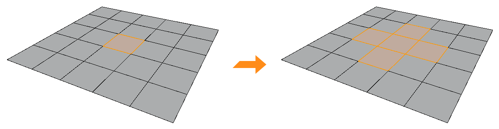

### Linked
**Keys:** L / Ctrl+L

L selects the connected part under the mouse, Ctrl+L the part connected to the selection.

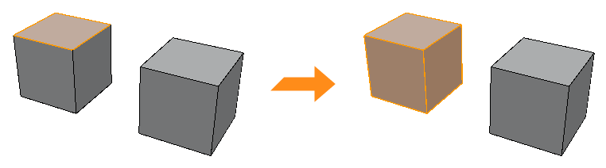

### Border

Selects the open edges of the mesh: edges with only one face.

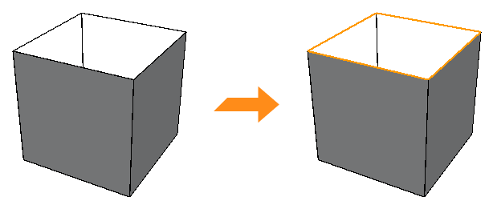

### Checker Deselect

Deselects every other element.


### Same Material

Selects the faces with the same material.


### Same Normal

Selects the faces facing the same way. The largest angle and "Connected only" are in the Last Operation panel.


### Invalid UVs

Selects the faces whose UVs have no area.

### Inner Faces

Selects the faces no one can see: inside the mesh's own solid (merged objects that overlap or touch).

### Hide / Reveal
**Keys:** H / Shift+H / Alt+H

Hides the selected faces, hides the other faces, or shows everything again. Hidden faces are hidden only in edit mode.


### Visible Selection

The button with the eye on the toolbar. When it is on, clicks go through faces turned away from the camera, so a room
can be edited from outside.

On:


Off:


### X-Ray
**Key:** Alt+Z

The selection goes through the mesh.


## Move, Rotate, Scale

### Move / Rotate / Scale
**Keys:** G / R / S

Works on the selected elements in edit mode and on the selected objects in object mode.

- X / Y / Z - an axis, Shift+X / Y / Z - a plane, pressed again - the local axis.
- The amount can be typed in.
- Ctrl - inverts snapping.
- Shift - slows the change down for precise moves.
- LMB or Enter - apply, RMB or Esc - cancel.

### Slide
**Keys:** G G

The selected elements slide along the edges. C - keeps the elements on the line of the current edge.


### Base Point
**Key:** B (during G / R / S and G G)

A click - the point from, a second click - the point to. Moves, rotates or scales by these points.

### Nudge with Arrows
**Keys:** arrows, Page Up / Page Down

Moves the selection by one grid step along the world axis closest to the view. With Ctrl in object mode a copy is
moved.

### Rotate with Arrows
**Keys:** Alt+arrows, Alt+Page Up / Page Down

Turns the selection by 90°.

### Gizmo
**Key:** W

Switches the gizmo: move, rotate, scale, none.

### Orientation
      

A menu on the toolbar: global, local, normal, gimbal, view, cursor, parent. "Create from Selection" adds an
orientation of your own from the selection.


### Transform Pivot
    

A menu on the toolbar: bounding box center, 3D cursor, individual origins, median point, active element.


### Proportional Editing
\
**Keys:** O / Alt+O

The neighboring elements move with the selection, less the farther they are. Alt+O - only the connected ones.

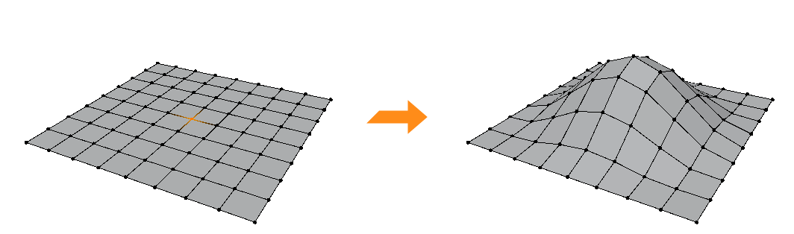

### Symmetry


A button on the toolbar, its axes in the menu next to it (X by default). When vertices move, their mirror twins on the
other side of the object's axis move mirrored.
- Works for move, rotate, scale, slide, and with proportional editing.
- Vertices on the plane of symmetry stay on it.
- New faces (extrude, duplicate) are not mirrored; HewnMirrorModifier does that.
- The operation panel turns symmetry on or off for each axis.


### Auto Merge


A button on the toolbar. Vertices that end up next to each other after a move are merged.

## Snapping

### Snapping
**Keys:** Y, Shift+Tab

Turned on with Godot's magnet. The snapping menu on the toolbar chooses what to snap to: step, grid, vertex, edge, face,
edge center, face center.

### Grid Step
**Keys:** `[`, `]`

Makes the grid step half or twice as big. The current step is shown next to the snapping menu.

### 3D Cursor
\
**Keys:** Shift+RMB, Shift+S

Shift+RMB puts the 3D cursor on a surface. Shift+S - the cursor menu: to the selection, to the world origin, the
selection to the cursor.

## View

### Shading
      

The shader used in the 3D viewport. "UV Stretch" colors how much the texture is stretched: blue none, then green,
yellow, red. "Angle" - the corners' angles changed in the UVs, "Area" - faces bigger or smaller than on the rest of the
object.


### Overlays


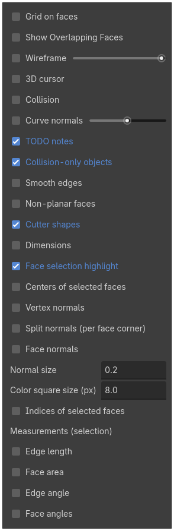

## Vertices

Mesh -> Vertex menu.


### Extrude Vertices
**Key:** E

Extrudes the vertices into new edges.


### Bevel Vertices
**Key:** Ctrl+Shift+B

Cuts the corners at the selected vertices.

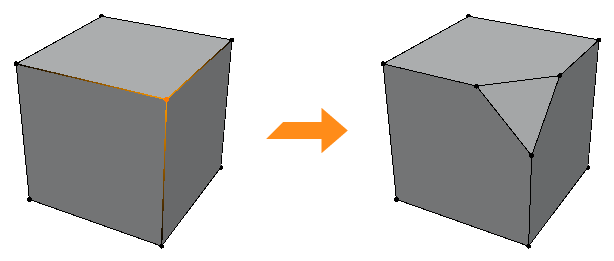

### Push / Pull

Moves the vertices toward the center of the selection or away from it.


### Shrink / Fatten
**Key:** Alt+S

Moves the vertices along their normals.


### Shear

Shears the selection.

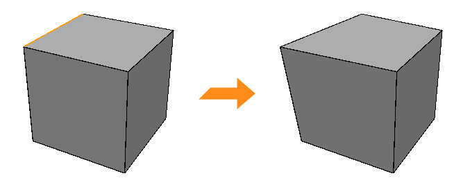

### Slide Vertices
**Key:** Shift+V

Moves a vertex along one of its edges.

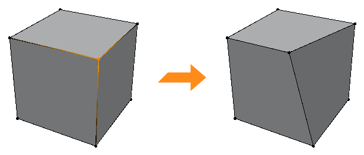

### Randomize

Moves the vertices by a random distance.


### Mirror

Mirrors the selection along an axis.

### To Circle

Puts the selected vertices on a circle.


### Connect
**Key:** J

Connects the selected vertices with edges across the faces.


### Rip
**Key:** V

Rips the selection off on the side of the mouse and moves it.


### Merge
**Key:** M

Merges the selected vertices: at the center, at the cursor, at the first, at the last, by distance.


### Drop / Raise to the Surface

Each selected vertex goes straight down (up) along Y to the nearest face under (over) it.


### Merge by Distance

Merges vertices closer than the given distance.

### Vertex Crease

The vertex stays sharp when subdivided.

### Separate
**Key:** P

Moves the selection into a new mesh. It can also separate by material or by loose parts.

### Dissolve Vertices
**Key:** Ctrl+X

Removes the vertices; the faces around merge.


### Delete Vertices
**Keys:** X, Delete

Deletes the vertices and their faces.

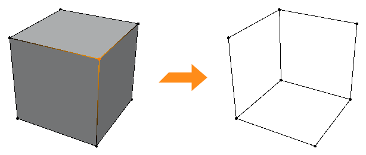

## Edges

Mesh -> Edge menu.

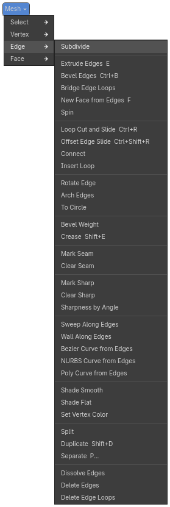

### Extrude Edges
**Key:** E

Extrudes the edges into new faces.


### Bevel Edges
**Key:** Ctrl+B

Cuts the edges off. The wheel or +/- changes the number of segments.


### Bridge Edge Loops

Joins two loops of edges with faces. In the operation panel: segments, smoothness, twist. With several segments handles
show at its ends: drag them. "Profile Factor" - how thick the bridge is in its middle, "Profile Shape" - how it changes.


### Sweep Along Edges

A sweep (a cornice) along the selected edges, outside the faces next to them. In face mode: along the border of the
selected faces.


### Wall Along Edges

A wall on the selected edges: a parapet, a fence. Its height, thickness and side are set later in the shape panel.


### New Face from Edges
**Key:** F

Makes a face from the selected edges or vertices. Two vertices - an edge between them.


### Subdivide

Divides the selected edges. Two opposite edges of a face: their new points are joined by an edge. With "Create N-gons"
off, the faces around become quads and triangles.


### Loop Cut and Slide
\
**Key:** Ctrl+R

Cuts a loop of faces. The wheel - the number of cuts, a click - cut, then slide with the mouse, a click - apply.

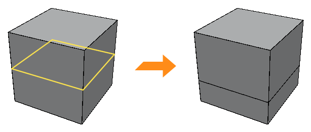

### Offset Edge Slide
**Key:** Ctrl+Shift+R

Adds edges on both sides of the selected ones and moves them away from the middle.


### Connect

Joins the middles of the selected edges.


### Insert Loop

Inserts a loop through the selected edge.

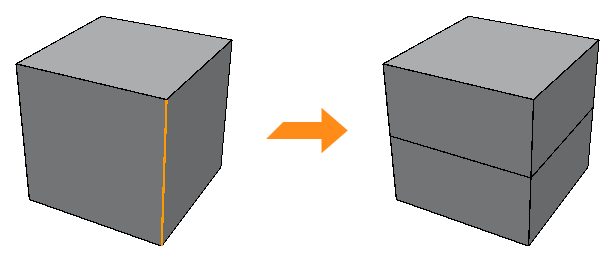

### Arch Edges

Bends the selected edges into an arc. Two opposite edges of a passage's ceiling make a vault. "Shape: Curve" takes the
arc from a curve; its points can be dragged in the 3D view.


### Rotate Edge

Turns the edge between two faces.


### Bevel Weight / Crease
**Key:** Shift+E (crease)

A creased edge stays sharp when subdivided.

### Mark Seam / Clear Seam

A seam stops a UV unwrap and a continued texture.

### Mark Sharp / Clear Sharp / Sharpness by Angle

At a sharp edge the normals of smooth faces are split.

### Split

Splits the mesh along the selected edges.

### Dissolve Edges
**Key:** Ctrl+X

Removes the edges; the faces on both sides merge.

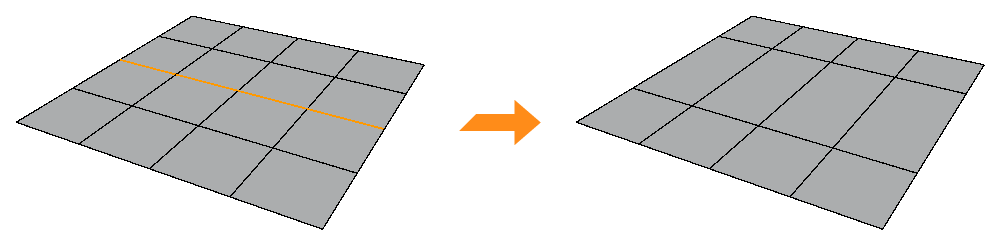

### Delete Edges / Delete Edge Loops


## Faces

Mesh -> Face menu.


### Extrude Faces
**Key:** E

Extrudes the faces together. Alt+E - a menu of the other kinds.


### Extrude Along Normals

Each vertex goes along its own normal.

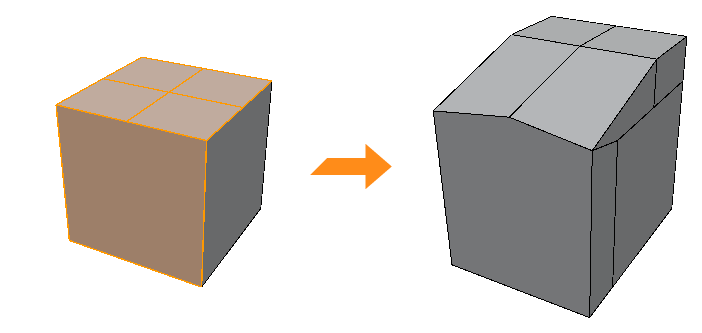

### Extrude Individual Faces

Each face is extruded on its own.


### Extrude Repeat

Extrudes the selection several times along its normal. In the Last Operation panel: the repeats, the distance and the
scale per step.


### Inset
**Key:** I

Makes smaller faces inside the faces.

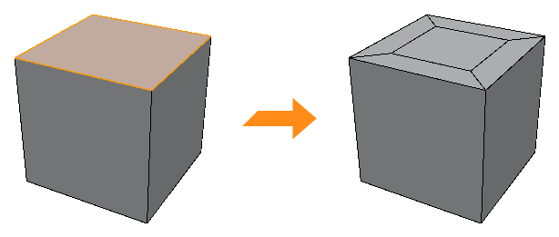

### Spin


Turns copies of the selection around the 3D cursor in steps.


### Poke

Splits a face into triangles with a vertex at the center.

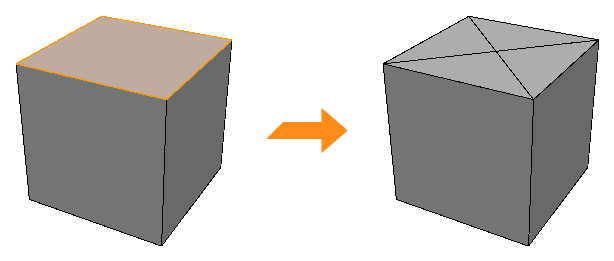

### Bridge Faces

Joins two faces with a tunnel; the faces themselves are removed. Segments, smoothness, twist and handles as for Bridge
Edge Loops.


### To Circle

Puts the border of the selected faces on a circle.

### Subdivide

Divides the faces.


### Triangulate

Splits the faces into triangles.


### Triangles to Quads

Merges pairs of triangles.


### Combine Faces

Merges the selected faces into one, the edges between them go.


### Thicken

The selected faces become a solid of their own: a back side and a rim. The thickness and the side are in the Last
Operation panel.


### Fill Hole

Closes a hole with a face.


### Shade Smooth / Shade Flat


### Flip Normals

Turns the faces around.


### Double Sided

Makes the selected faces visible from both sides: a leaf, a fence, a thin wall made of one sheet. The back gets its own
turned normals, so it is lit right and no special material is needed. The same command again makes them
one-sided. The face inspector has the same switch.


### Recalculate Outside / Inside
**Keys:** Shift+N / Ctrl+Shift+N

Turns all the faces outward or inward. Alt+N - the normals menu.

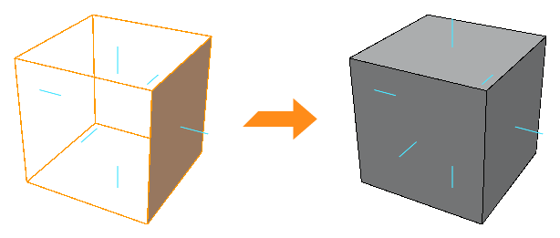

### Detach

Tears the selected faces off their neighbors; they stay in the same mesh.


### Duplicate
**Key:** Shift+D

Copies the selection and moves the copy.


### Dissolve Faces / Limited Dissolve

Merges faces. Limited Dissolve - only those meeting at a small angle.


### Delete Faces


### Face Drag
**Key:** Shift+drag

In object mode, on a selected object: moves a face along its normal; the faces around stretch; the face under the mouse is outlined in yellow. Ctrl+Shift+drag outward extrudes a new block from the face;
inward it cuts the object: the part dragged through becomes an object of its own.

### Face Cutter


Cuts a face with lines from one of its edges.

## Tools

The tool column on the left of the viewport.


### Box Select
  


### Ruler
\
**Key:** Shift+M

A drag - a new ruler. Drag its middle - an angle. X or Delete over a ruler - delete it.


### Knife
\
**Key:** K


Clicks place points, Enter cuts. RMB ends the current cut. A - 30° angle steps, Ctrl - the middle of an edge. A point
snaps to vertices, edges and the knife lines already drawn. All the cuts are made at once: where they cross a vertex is
placed, each face is split into pieces without overlaps.

### Loop Cut
\
**Key:** Ctrl+R


### Box Cut


Draws a rectangle, a circle or a polygon on a face and cuts it out, cuts along it, or extrudes it. The rectangle and the
circle: a drag, or a click on one corner and a click on the other; then, when it needs one, a click for the depth.
X / K / J / I / M: cut, slice, join, intersect, make.

### Bisect


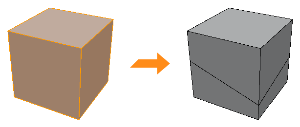

In edit mode: draw a line across the mesh; the plane through it and the view cuts the selection. In the panel: "Cut
Only", "Cut and Fill" (two closed parts), "Remove Above", "Remove Below" ("Fill Hole"). The arrow on the plane moves it,
two rings turn it (Ctrl - snapping). "Cut and Fill": both parts are closed, the lower one is an object of its own
("Separate the Part Cut Off").

### Clip
\
**Key:** Alt+X


A tool of its own (scissors in the tool column), in object and edit mode: clicks place 2 or 3 points, the plane
through them cuts, Ctrl+Enter - what to keep, Enter - apply.

### Spin


A ring around the 3D cursor: drag it and the selection turns around the axis. X / Y / Z / V - the axis.

## Level Tools

### Box / Cylinder / Prism Cutter
**Key:** C (box)

Drawn like a shape and cuts its volume out of the meshes. Works on the mesh being edited, on the selected objects or on
the whole scene.


"Frame" in the cut's panel: the hole's sides (as W makes them) and a frame round it - sweeps on the wall along the sides
asked for ("Top Side", "Bottom Side", "Left Side", "Right Side"), on its "Outer Side", "Inner Side" or "Both Sides".
"Profile", "Width" (on the wall) and "Depth" (out of it). A cut makes each frame a sweep on a curve of its own; a cutter
node keeps its frame with it and makes it again when it moves.


### Mesh Cutter

"To Mesh Cutter" in the cutter's panel (or Object -> "Cutter -> Mesh Cutter"): the cutter becomes a Hewn mesh of its
shape, edited like any mesh, that cuts the meshes it overlaps by a boolean; its corridor and frame are gone. Any Hewn mesh
becomes one with "Mesh Cutter" in the Inspector. The meshes are cut again a moment after its edit stops; the new faces
get the first material with world UVs. A mesh cutter that is not closed cuts nothing and has a warning in the scene
tree.

## Objects

Object menu.

### Apply Transform

Moves the position, rotation and scale into the vertices.

### Origin to Geometry / to 3D Cursor / to Selection

Moves the object's origin; the geometry stays in place.

### Subdivide (Catmull-Clark)

Smooths the mesh by subdividing it.

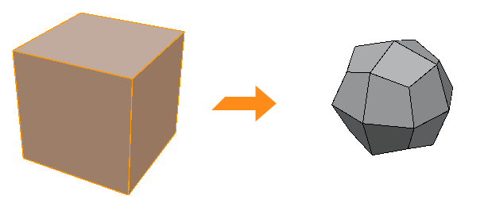

### Remesh

The Object tab of the Hewn panel. Builds the selected meshes again, keeping their shape. The mesh must be closed.
- "Voxel": faces the size of a voxel. Adaptivity lowers the number of faces on flat areas, "Fix Poles" lines the
  vertices up along the surface. The volume and the attributes (vertex colors, smoothing) can be kept.


- "Quad": quads of the density you want: by a number of faces, by a ratio to the current number of faces, or by edge
  length (the approximate number of faces is shown). Variation shifts the grid. The grid follows the axes, not the
  bends of the shape.


### Collision

The Collision Only check box: the game keeps only the object's collision (an invisible wall).

The Collision group in the Inspector of a Hewn mesh. Its kinds:

- Trimesh


- Convex

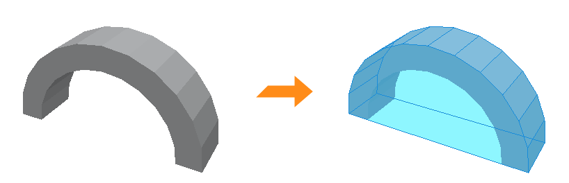

- Simplified Convex

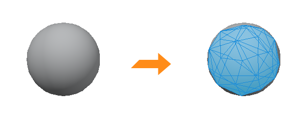

- Multiple Convex


- Box


- Capsule


- Cylinder


- Sphere


- Simplified Trimesh


Metadata and Groups are put on the mesh and its collision body when baking. Collision Layer and Collision Mask in the
Collision section are the body's layers.

### Auto Smooth

Smooth shading with sharp edges by angle.

### To Quads

Merges the triangles of the whole mesh into quads.


### Conform Normals / Triangulate All / Flip All Normals

### Apply Modifiers

Moves the result of the modifiers into the mesh itself.

### Join Selected Objects

**Key:** Ctrl+J

### Remove Inner Faces

Removes the faces that cannot be seen at all: inside the body after joining objects that cross or touch. The inside
of a room (faces turned inward) stays. In edit mode "Select -> Inner Faces" only selects them. Limited Dissolve then
removes the extra edges on flat areas.

### Boolean Union / Difference / Intersection
  

Union:


Difference:

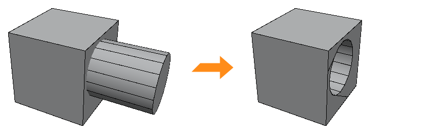

Intersection:


### MeshInstance3D -> Hewn

Turns a plain mesh (or a CSG shape) into a Hewn mesh.

### Bake to MeshInstance3D

Makes a plain MeshInstance3D of the selected Hewn meshes and curves.

### Export OBJ / Export glTF

Saves the selected mesh to a file (glTF or FBX).

### Object Menu
**Key:** RMB

In object mode: origin, cursor to selected, shading, normals, duplicate, delete, clear and apply transform.


### To Floor / To Ceiling

The selected objects go straight down (or up) until they touch: by their mesh or by their origin; "Along Surface
Normal" turns them to it. The panel at the bottom left.

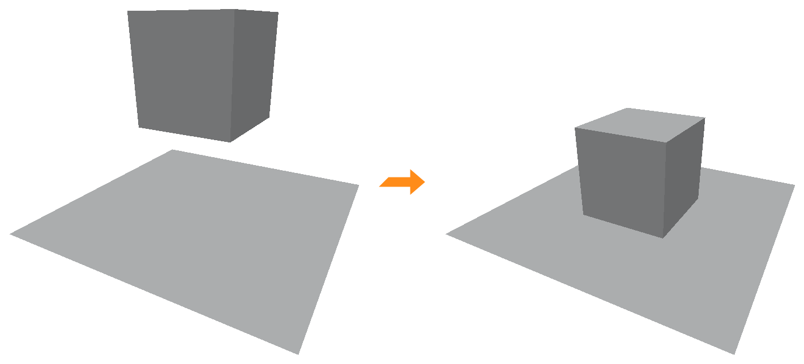

### Physics Placement

The selected objects fall onto what is around them and settle. They can be dragged with the left button. "Apply"
(Enter) leaves them there as one undo step, "Cancel" (Esc) puts them back. Gravity is in the panel.

### Convert to Collision

The selected meshes as collision shapes of their form: convex, Trimesh, box, sphere, capsule, cylinder; in a static
body (the default), in an Area3D or on their own; "Keep Mesh" puts the body under the mesh.

### Delete
**Key:** X

In object mode deletes the selected nodes.

### Isolate / Frame Selected
\
**Keys:** / , .

## Modifiers

Modifiers are added in the Inspector, in the Modifiers array (Add Element). They work top to bottom; the order is
changed by dragging.

### HewnMirrorModifier

Mirrors the mesh along axes or along the planes of another node.


### HewnSolidifyModifier

Gives the mesh a thickness.


### HewnSubdivisionModifier

Smooths the mesh by subdividing it.


### HewnBooleanModifier

Joins, subtracts or intersects the mesh with other objects. The objects stay operands and can be moved.


### HewnArrayModifier

Copies of the mesh along a line, in a circle or along a curve. On a Hewn curve with several splines "Per Curve" gives
the count to each. "Fit Curve Length": a line of as many copies as fit the length of the curve. "Caps": a mesh before
the first copy and after the last.


### HewnCurveModifier

Bends the mesh along a curve: the "Deform Axis" goes along the first spline (from the curve's origin), the other two
across it, with the curve's tilt and radius.

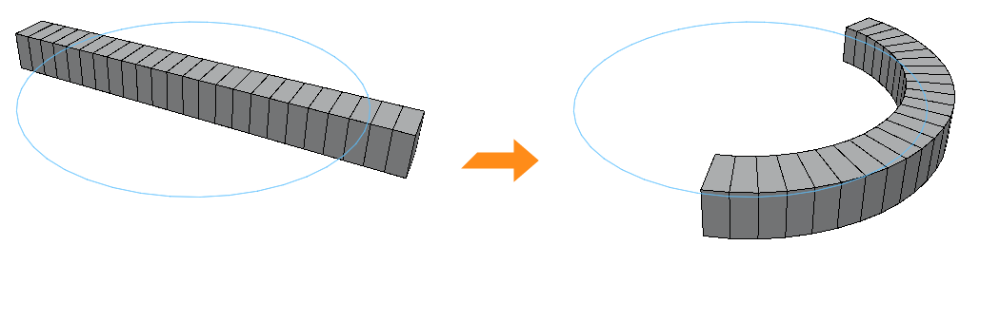

### HewnRemeshModifier

Builds the mesh again on a voxel grid: Blocks (cubes), Smooth, Sharp (sharp corners kept, how much by Sharpness) or
Voxel (by the voxel size). For the first three, Octree Depth and Scale set the cell size. Remove Disconnected removes
small separate pieces, Smooth Shading turns on smooth shading. Quad and Triangles build a mesh of quads or triangles of
about Target Faces faces.


### HewnFractureModifier

Breaks the object into pieces (Pieces, Seed); the cuts get the Inner Material, Gap moves the pieces apart. In the game
the pieces are one mesh, a mesh each, or frozen RigidBody3D nodes (group hewn_pieces).

Right click on an object -> "Apply Modifier" applies only that modifier.


### HewnSimplifyModifier

Simplifies the mesh. Collapse keeps a share of the triangles (Ratio), Planar merges neighboring faces that meet at an
angle smaller than the limit (Angle Limit).


## Textures

### Textures Dock

The pictures of the project. A click on a picture puts it on the selected faces, in object mode on the selected
objects. A picture can be dragged onto a face or an object.

The material for a picture is made once in the materials folder and reused after that.


### Texture Transfer
**Keys:** Alt+click, Ctrl+Alt+click, Alt+RMB

With one face selected, Alt+click carries its texture onto other faces; the pattern continues across the edges. Dragged,
onto every face under the mouse.
Ctrl+Alt+click carries only the UVs. Alt+RMB takes the texture of the face clicked.

### Texture to Edge
**Key:** T

Puts the texture against the edge under the mouse. W / A / S / D - which side, Q - fit the height, E - fit the width,
R - scale 1. A click, Enter or T - apply, Esc - cancel.


### Texture Transform
**Key:** Shift+T

Shows a tile of the texture on the chosen face with handles: corners and sides - scale, the middle - move, the circle -
turn. G / R / S - the same with the mouse, no handles. A click off the handles or Enter - apply, Esc - cancel.


### Texture Tools
**Key:** U

The same tools as in the UV tab, in a menu at the mouse. With "Move / Rotate / Scale Texture" the texture follows the
mouse: X / Y - an axis, Ctrl - in steps.

- **Cycle** - a quarter turn.
- **Flip U / V**
- **Fit U / V** - one tile across the width or the height.
- **Center**, **Fit to Face**, **Random Offset**
- **Cube Projection**
- **Continue from Active** - the texture of the last selected face goes on to the others.
- **Unwrap Quads to Tile** - a strip of quads laid out into one tile.
- **Copy / Paste UV Rectangle**

### World UVs

The texture comes from the face's place in the world: neighboring objects join without seams. In the UV tab it is
turned on for new objects; "Apply World UVs" switches the selection over. The UV islands stay at the first tile, even
when the object is far from the center of the scene.

The texture is projected along the nearest world axis, so on slanted faces it is stretched. "Align to Face" projects
it onto the plane of the selected faces at its true size (a seam may appear with the neighbors), "Align to Axis" puts
it back.

### Hotspots

An atlas (a trim sheet) is a material whose image is cut into rectangular cells. Each face, or each piece of joined
faces, gets the cell that fits its shape and size: a level is textured without unwrapping.

The Hotspot tab of the Hewn panel puts atlases on the selected meshes and lays them out.

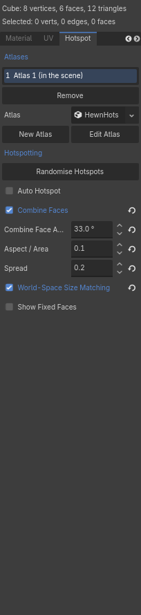

- The list - the mesh's atlases. "New Atlas" adds one (saved as a file at once), "Remove" takes the picked one off, the
  field below changes it. With several atlases each face gets a cell of the one that fits it best (an outer wall the
  cladding's, an inner one the wallpaper's), and that atlas' material.
- "Randomise Hotspots" - the faces get the cells that fit them; each press gives another look (other cells, turned).
- "Auto Hotspot" - laid out again a moment after each change.
- "Combine Faces" - joined faces bent less than "Combine Face Angle" are one piece. A band of faces (a bent beam, a
  spun wall) is laid out along its bend; a strip repeating along U goes on round corners. Mark seams to cut a piece.
- "Aspect / Area" - the cell by the piece's shape (left) or by its size (right). "Spread" - how much a cell may fit a
  little worse and still be picked by chance.
- "World-Space Size Matching" - sizes in meters (World UV's pixels per meter).
- Edit mode: "Choose Hotspot" - a cell for the selected faces from a palette (they become fixed); "Fixed"; "Hold to
  Atlas" / "Any Atlas" - the faces keep to the picked atlas or take any.

"Edit Atlas" opens the Hotspot Atlas panel at the bottom.


- "Atlas" - the atlas edited (a resource: "New" saves it as a file). "Material" - its image is the one cut; "Image" shows
  only when the material has none. "Scale" - all its cells bigger or smaller in the world.
- A click cuts the image across the way the mouse went (Ctrl: this cell only). Drag a cell, a cut or a corner; Shift+drag
  draws a new cell. X / Delete - the cut or the cell away. Wheel - zoom, middle button - pan, F - all of it.
- The cell list: the check box leaves a cell out. Picked cells (Ctrl / Shift for several) get the settings below:
  - the kind of faces ("Any", "Upwards", "Floor", "Ceiling"), "Toggle Tiling" (a cell from side to side of the image),
    "Scale";
  - "Sides" - any, outside, inside, the sides of an opening; "Turn", "Mirror", "Weight" (how often), "Min Size" /
    "Max Size" (meters), "Padding" (pixels);
  - "Radial" - a round cell: round faces (a cylinder's ends) get it, other faces never.

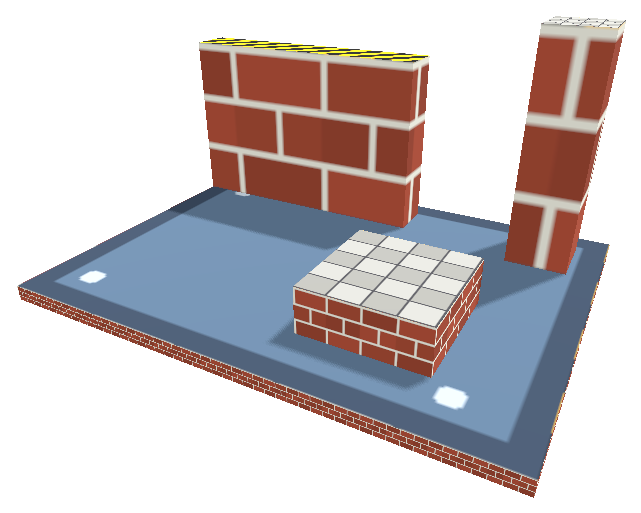

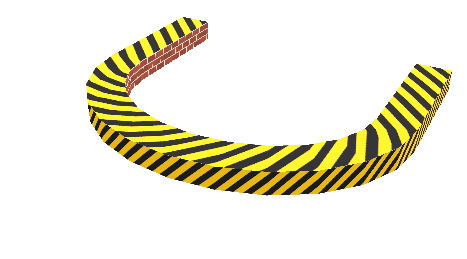

### Unwrap
**Key:** U

The U menu in edit mode, for the selected faces. The islands are laid out in meters, next to each other.

- "Mark Seam" / "Clear Seam", "Seams by Angle" - seams where the faces bend more than the angle.
- "Unwrap (Angle Based)", "(Conformal)", "(Minimum Stretch)" - each island by its seams laid flat.
- "Smart UV Project" - faces grouped by direction, each group projected flat.
- "Cube", "Cylinder", "Sphere Projection", "Project from View" (with the view's perspective).
- "Relax" - less stretch, the islands in place.


#### Quadrify

Select an edge (or a face) of a band of quads: the band is opened along that edge's line, from seam to seam, and laid
out as a straight grid. Several islands are laid out each on its own. In its panel: "By Selected Edge", "Orientation",
"Repeats Across" (the texture that many times across the band: a curb, a winding corridor's floor).

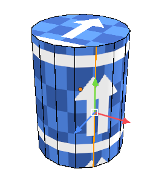

### UV Lock

Faces moved in edit mode take their texture with them.

### Material Tab

The mesh's materials and the texture settings of the selected faces: filtering, transparency, vertex colors,
roughness, metallic.

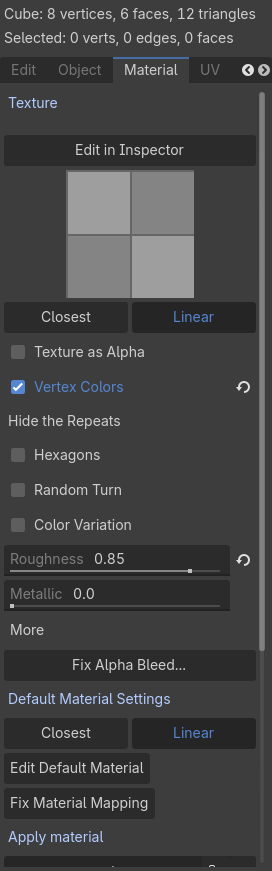

### Hide the Repeats

The "Hexagons", "Random Turn" and "Color Variation" check boxes make a shader material from the material, the texture's
repeats not lined up in it.

### Tool Materials

The Clip material is not drawn in the game but has collision. It is used for invisible walls.

### Lightmap UV2

Scene tab. Builds a second unwrap for light baking.

## UV Editor

The Hewn UV dock: the UVs over the texture. The UV / UV2 switch in its header: the second channel is edited the same way.

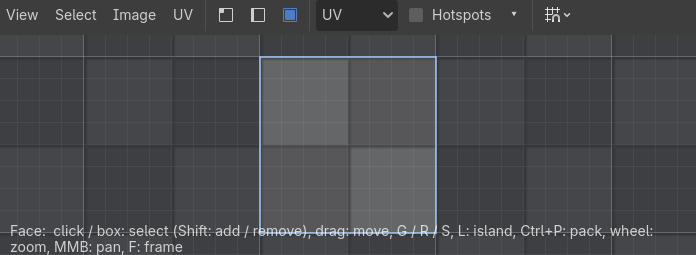

- The first button - selection sync: all the islands shown, the selection the same here and in the viewport. Off: only
  what the viewport selects ("View" -> "Isolate Islands": its whole islands). In object mode all of them.
- 1 / 2 / 3 - UV vertices, edges, faces. Click, Shift+click, box - selection; L - the island under the mouse.
- G / R / S or drag - move, rotate, scale; type a value (R 90 Enter), X / Y - one axis.
- H / Shift+H / Alt+H - hide the selected, the rest, show all again.
- U - unwraps and projections (as in the viewport), "Quadrify", "Relax", "Pack Islands", "Align Horizontally" /
  "Vertically", "Distribute Evenly", "Select Overlapping Islands" (one of each stack), "Stack Similar Islands" (the
  selected ones onto a similar one that is not), "Fit to Hotspot Cell" (whole, its width or its height).
- Ctrl+P - pack; its options (rotate, texel density, pixel density, margin) in the panel bottom left after it.
- "View": "Stretch: Angle" / "Area" with its opacity, "Similar Islands" in colors. "Image": "Tile Texture".

## Sculpting


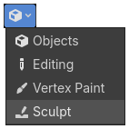

The mode is chosen in the menu at the start of the toolbar. Good for small terrain and soft shapes. LMB - a stroke; the
whole stroke is undone with one Ctrl+Z. Ctrl - the brush works the other way, Shift - smoothing with any brush.
Ctrl+wheel or [ / ] - radius, Shift+wheel - strength. If something is selected in edit mode, only the selection is
sculpted.

The tools in the column on the left:
- Raise / Lower.
- Smooth.
- Flatten - to the plane under the brush, with Ctrl - to the height where the stroke began.
- Grab - the area taken follows the mouse.
- Noise.
- Terrace - the heights are rounded to a step (the Step field on the toolbar).
- Pinch, Inflate.
- Sharp Edge - a groove, with Ctrl - a ridge.
- Density - only changes the detail (shown when dynamic topology is on).

On the toolbar: the radius in pixels, strength, direction ("Up" - straight up, slopes never fold over; "Along the
Surface" - out of the surface under the brush, the default), falloff (as in Vertex Paint, and "Custom" with a curve of
its own), pen pressure (on strength and on radius) and the cursor (on the screen or on the surface, its color).

### Dynamic Topology


A check box on the toolbar. Under the brush the surface is split into triangles of the right size: long edges are
split, short ones collapsed. The refine method: subdivide, collapse, or both. The detail: relative (in pixels on the
screen), constant (in meters) or brush detail (in percent of the radius).

## Vertex Paint


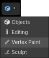

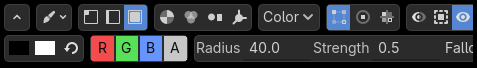

The mode is chosen in the menu at the start of the toolbar. Vertices, edges or faces are painted (1 / 2 / 3), and if
something is selected, only the selection.

### Brush


LMB paints. Ctrl+wheel - radius, Shift+wheel - strength, Ctrl+click - pick a color.

### Pencil


Paints one vertex.

### Fill


Paints the selection or a connected part. Fill Spread (on the toolbar): each channel goes up or down at random by
up to its value - per vertex, per face or per connected piece.

### Select by Color

The Colors menu -> "Select by Color...": the vertices whose value in the channel (the color or CUSTOM0-3) is within the
threshold of the given color, in the components checked; in face mode the faces all of whose corners are.

### Eyedropper


Takes a color. With Shift - into the second color.

### Normals


LMB makes the normals smooth, Ctrl+LMB flat.

### Colors
**Keys:** X, D


X swaps the two colors, D resets them to black and white.

### Bake Light

The Colors menu or Object -> "Bake Light to Vertex Colors". Writes the light and shadows of the scene's lights into the
vertex colors.

### Blend Material

The Material tab. Blends up to four textures by the vertex colors. Check boxes in the window give each texture
metallic and roughness, a normal map, an ambient occlusion map, emission; their values are set in the Inspector. "Scrolling": the textures move
(scroll angle and speed), with a shader of its own.
- Noise mask: the borders between the textures are broken up by a noise; each layer has its own strength, the noise's
  scale and softness are shared.
- Lift by paint: a layer lifts the vertices up by its height where it is painted (snow). The collision does not change,
  and the lift shows only on a dense enough mesh.

### Scrolling Material

Material tab -> "Scrolling Material": the picture (of the selection's material, or of the texture picked last) moves
across the faces (water, a conveyor). Its direction and speed are in the Inspector; a shader of its own, the plain
materials stay as they are.

## Texture Paint


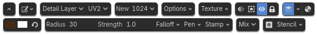


The mode is chosen in the menu at the start of the toolbar, Tab leaves it. It paints on the textures of the selected
mesh (a Hewn mesh or any MeshInstance3D). What is painted is chosen on the toolbar:
- Albedo - the material's own texture (UV1). On a tiled material the stroke shows on every repeat.
- Detail Layer - a picture of its own over the material (the material's Detail layer), on UV1 or UV2. On UV2 every face
  has its own place (a Hewn mesh gets the lightmap's unwrap); the material becomes this mesh's own.

When the material has no picture yet, the first stroke makes one ("New" - its size) as a PNG next to the scene. The
pictures are written when the scene is saved, when the mode is left, and with Texture -> "Save the Pictures". A stroke
is undone with one Ctrl+Z.

LMB paints. Ctrl+wheel or [ / ] - radius, Shift+wheel or Shift+[ / ] - strength, Shift+drag - radius (Ctrl+Shift+drag -
strength), Ctrl+click - eyedropper, X / D - the colors. Options: only what is seen (not through the mesh), also the
faces turned away.

### Draw and Erase
 \
**Keys:** B / E

Draw paints with the color in the chosen blend mode (Mix, Add, Subtract, Multiply, Lighten, Darken). Erase makes a
Detail layer see-through again and brings the albedo back to how it was when the mode started.

### Blur, Fill, Eyedropper
  

Blur softens the picture. Fill fills the piece of the surface under the click (its UV island). Eyedropper takes a
color, with Shift - into the second color.

### Pen and Stamp

- Pen: the pressure on the size and the strength (with a curve), the tilt turns or flattens the stamp, the speed makes it
  smaller or weaker.
- Stamp: a picture as the brush's tip (in its own colors or as a mask), spacing, angle, turning along the stroke, random
  angle, scatter, random size and strength.
- Falloff: as in Vertex Paint.

### Stencil


The Stencil button: a picture over the view; where the brush goes, it is painted onto the mesh in its colors.
Alt+drag moves it, Alt+Shift+drag scales, Alt+Ctrl+drag turns. Its opacity is only how it is shown.

## Pose Mode


Tab on a Skeleton3D (or on a skinned mesh, or on a character holding a skeleton), or the menu at the start of the
toolbar; Tab leaves it. The bones are drawn over the view:
- click - select, Shift+click - add, a drag - a box (Shift adds, Ctrl removes);
- A, Alt+A, Ctrl+I - all, none, invert;
- [ / ] - the parent / the children (with Shift - added), Ctrl+Shift+M - the other side;
- H, Shift+H, Alt+H - hide, hide the rest, show again.

G / R / S move, rotate and scale the selected bones with the same axes, typed values, orientation (Local - the active
bone's axes), pivot and snapping as objects. Alt+G / Alt+R / Alt+S bring the location / rotation / scale back to the
rest pose. Ctrl+C / Ctrl+V copy and paste the pose by the bones' names, Ctrl+Shift+V pastes it flipped (Arm.L onto
Arm.R).

### X Mirror and Auto IK
 

- X Mirror: the bone of the other side follows mirrored (names with .L / .R, _L / _R, Left / Right).
- Auto IK: G on a bone turns its parents so that the bone comes to the mouse. Chain - how many parents (0 - up to the
  root).

### Keyframes
 \
**Keys:** I, Alt+I

I keys the selected bones into the animation open in the Animation panel, at its time (the AnimationPlayer above the
skeleton); what the keys hold is chosen on the toolbar. Alt+I deletes them. Auto Keying keys every change of the pose.
Ctrl+Z undoes the keys too.

## Rigging


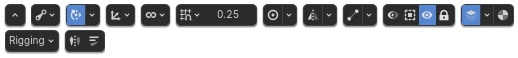


The menu at the start of the toolbar with a Skeleton3D selected, or Ctrl+Tab in Pose mode; Tab leaves it, Ctrl+Tab goes
to Pose mode. A new skeleton: Shift+A -> Skeleton (one bone at the 3D cursor). The bones are shown at rest; the
meshes on the skeleton stay where they are while it changes.

The points are the bones' heads and tails; a child that starts at its parent's tail is joined to it and moves with it:
- click - a point, a click on a bone - both its ends, Shift - add, a drag - a box (Ctrl removes);
- A, Alt+A, Ctrl+I - all, none, invert; Ctrl+Shift+M - the other side;
- G / R / S - move, rotate, scale the points, with the same axes, typed values, pivots and snapping as everything
  else. A bone keeps its Y axis toward its tail and its roll.

The Rigging menu:
- Extrude (E) - a new bone from each selected tail, then moved;
- Add Bone (Shift+A) - at the 3D cursor;
- Duplicate (Shift+D), Delete Bones (X) - the children go to the bone above, the meshes' weights of a deleted bone too;
- Subdivide - each selected bone in two;
- Make Parent (Ctrl+P) - the selected bones under the active one, Clear Parent (Alt+P);
- Rename (F2) - the animations' tracks of the bone are renamed too;
- Roll (Ctrl+R) - the bone turns about its axis with the mouse (Ctrl - by 5 degrees);
- Symmetrize - the other side's bones (.L / .R, Left / Right) made or put mirrored.

X Mirror: the other side's joint moves mirrored, Extrude makes both sides.

### Binding

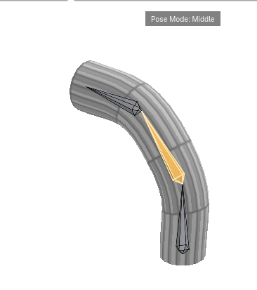

Object menu -> "Bind to Skeleton" with Hewn meshes and the skeleton selected (or the Rigging menu: the Hewn meshes
under the skeleton). The mesh goes under the skeleton, its vertices stay where they were, it gets a skin and weights:
- Automatic Weights - by the nearness to the bones, smoothed over the surface;
- Nearest Bone - each vertex on one bone;
- Empty Weights - to be painted.

The weights are kept through the editing: new vertices take the weights of the nearest old ones. "Unbind from
Skeleton" takes them away.

## Weight Paint


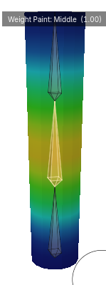

The menu at the start of the toolbar with a bound Hewn mesh selected; Tab leaves it. The mesh is colored by the weight
of one bone (blue - none, green - half, red - all), the skeleton shows its rest. The bone is picked in the toolbar or
with Ctrl+click (on a bone, or on the mesh - its strongest bone there).

Tools: Draw (toward the Weight), Add, Subtract, Smooth, Sample (takes the weight). Radius, Strength, Ctrl+wheel and [ / ] as
in the other brushes. Options: auto normalize (the other bones make room), only the faces turned to the view, falloff,
pen pressure. X Mirror: the vertex on the other side gets the same weight of the other side's bone. A stroke is undone
with one Ctrl+Z.

The Weights menu: Normalize All, Clean (weights under 0.01 out, at most 4 bones), Smooth the Bone, Clear the Bone,
Mirror Weights to the Other Side, Automatic Weights Again.

## Scenes and Objects

### Scenes Dock

A click on a scene - the scene follows the mouse, releasing places it. Q / E - turn by 90°, N - along the surface
normal, R - another random turn. "Placement..." - random rotation and size. RMB on a scene: add it to the favorites
(Shift+A -> Favorites) or show it in the FileSystem.

### Entities

The Create tab. A light, a spotlight, a sound and objects of your own from `res://hewn_entities.json`.

### Decals and Overlays

A picture on a surface. A decal is a Godot Decal node. An overlay lies on Hewn faces and is saved as geometry. - / = while
placing change the size.

The corner points of an overlay can be dragged with the mouse right in the viewport; the picture warps after them. In the
Inspector, in the Shape section:
- Control Points: 4 points or 9 (with them the sides can bend).
- Reset Shape: back to a rectangle.


An overlay can be mirrored and cut with the Clip tool.

### Reference Image

Shift+A -> Image. A picture to trace over; not seen in the game.

### Scatter
  

Shift+A -> Scatter. Copies of meshes or scenes painted on surfaces: grass, rocks, bushes. In the Inspector: the meshes and their
weights, density, brush radius, random rotation (also around X and Z), tilt and scale, "Base Rotation" (for a mesh made
lying down), "Align" (up or along the surface normal), offset. "Collisions": per mesh (convex, trimesh, box), made when
the game runs and when baking. While the node is selected, its brushes are in the tool column:
- Brush: adds copies. Ctrl - erase, Shift - thin out.
- Erase, Thin Out.
- Ctrl+wheel or [ / ] - radius.

While it is selected, its bottom panel opens: the meshes (Ctrl / Shift - several; the brush places the selected ones,
or all if none), "Add Mesh", "Remove", "All" / "None", "Erase Strength" (below 1 the eraser thins out) and the brush
settings (density, radius, scale, rotation, tilt, offset). Tab leaves the brush, like Esc.

The copies are kept in chunks ("Chunk Size"), each drawn by its own MultiMeshInstance3D with a "Visibility Range". A
stroke rebuilds only the chunks it touches. Baking turns them into plain MultiMeshInstance3D nodes.


### Baking the Level

Bake Level opens its options first, then asks for the file. They are kept in the project and used when the game is
exported too.
- Occluders: for big opaque meshes. They work only with occlusion culling on in the Project Settings; the window warns
  when it is off.
- Merge static meshes: small objects with the same metadata, groups and render settings are joined in squares of the
  map.
- Split big meshes: detailed meshes bigger than the given size (128 m by default) are cut into squares of that size.
- Both leave alone objects with a script, under a moving parent, or with lightmap UV2. For one object: Merge At Bake in
  the Inspector.
- Also plain meshes: by default MeshInstance3D nodes not made by Hewn are neither joined nor cut.
- Merge collision, Detail levels (LOD), Visibility range by size, Remove hidden faces.

Run Baked: the level as it will be after export. F5 runs the editable nodes, unbaked.

Meshes, curves, scatters and things along curves have metadata, groups and scripts for their game nodes. The object's
script extends MeshInstance3D (a mesh) or Path3D (a curve), a collision script StaticBody3D.

### Roads and Bridges

Shift+A -> Curve -> Road (Overlay on the Ground), Road (Mesh on the Ground) or Bridge. Any curve can have one too: the
Road section of the Inspector. Pick its texture by clicking one with the curve selected. The picture lies once across
the road and repeats along it.
- Mode: off, mesh or overlay.
- Width: the width.
- Repeat: the length of one repeat of the picture along the road (0 - from its proportions).
- Reach: how far under the curve a surface is looked for.
- Step: how often along the road the height is checked.

An overlay lies on the highest surface under the curve and follows it when that is edited, adding no vertices to the
mesh. Softness is how soft its edges are, in meters; Order is which road is on top where they overlap. Edge Noise makes
the soft edge ragged: by a noise of Edge Noise Size and by the brightness of the road's texture (Edge Height) or a
height map of its own.

A mesh runs exactly along the curve, or with Snap on goes down onto the surface under it. Its settings: segments
across, thickness, curb height and width, lift off the ground. A bridge starts with curbs, collision and piers placed
along the curve. Side Material is a separate material for the sides, curbs and underside, Bottom turns the underside
off.


### Curves


Shift+A -> Curve: Bezier, Circle, NURBS Curve, NURBS Circle, Path3D, Rope. A Hewn curve is a Path3D (PathFollow3D works
with its first spline) made of several splines: poly, Bezier or NURBS, with a radius and a tilt at each point. In the
Inspector: "Resolution", "2D" (in the XZ plane, "Fill" fills closed ones), "Offset", "Extrude", "Taper Object", the
bevel ("Round" with a depth and resolution, "Object" - the shape of another curve, "Profile" - a quarter turned round),
"Fill Caps", material, collision. In the game it is a plain Path3D with its own mesh.

A curve is drawn point by point like a wall. Without "Bake Path" it is not a Path3D in the game.

Walls, sweeps and path stairs are made on a curve of their own and follow it. "Convert to Curve" (right click on the
object) gives one to a shape without it.

Tab - editing the points:
- Click / Shift / box: selection, A / Alt+A, Ctrl+I. A handle can be dragged with the mouse, or clicked to select it
  for G / R / S.
- G / R / S, X / Y / Z (again - local), Ctrl - snapping, Shift+Tab - snapping on / off, B - from point to point.
- Alt+S - radius, Ctrl+T - tilt, Alt+T - clear tilt.
- E - extrude: after an end a new point; a run of points in the middle is pulled out, with new points at its borders. F - make a segment (join two ends or
  close a spline). Ctrl+click - a point at the mouse. Shift+D - duplicate.
- V - handle type, Alt+C - cyclic, Shift+N - recalculate handles, P - separate, Ctrl+X - dissolve, X - delete.
- Ctrl+B - bevel: the selected points become arcs, the wheel sets the segments.
- GG - the points slide along their pieces. M - merge the selected points.
- RMB - a menu: subdivide, draw (a stroke on the plane of the 3D cursor or on surfaces), smooth (position, tilt,
  radius), simplify, set radius / goal weight, mirror, snap, spline type, direction, split.

RMB in object mode: to mesh, origin, duplicate, mirror, snap. The same is in the Curve menu on the toolbar while a curve
is selected. "Mesh -> Curve" (Convert) and "Create from Edges" (the edge menu) make curves from edges. A click
anywhere on a curve selects it. While its points are edited it is out of the selection (no gizmo); Esc leaves like Tab;
Ctrl+click on a spline selects all its points; during G / R / S a number can be typed (S Y 0), Shift+X / Y / Z - all
axes but that one; R twice - trackball; points snap to the points of curves. The Draw tool is in the tool column while
the curve is edited.

"Placements" (Inspector): meshes along it, each a MultiMesh: in the middle, on the left, on the right or on both sides
("Offset"), as many as fit ("Spacing" 0 - by the mesh's length) or at a given distance, at random ("Spacing Random",
"Chance", "Spread", scale, rotation), in stretches ("Patch Length", "Patch Amount"), dropped onto the ground under
them, with collision. "Reach Ground": each copy is stretched down to the surface (piers, posts).

"Vertex Paint" (Inspector): the meshes under it are painted (a color or CUSTOM0..3, width, falloff, strength, height):
a path with a blend material. It is shown and baked but not saved in the mesh: move the curve away and the colors come
back.

### Building

Shift+A -> Curve -> Building: a rectangle drawn with two clicks (its corners). The building (HewnBuilding3D) is made on
its outline curve: the floor, walls, windows and roof follow its points.

The floors are a list in the Inspector (bottom up), each with:
- its wall height, floor and wall thickness, whether it has a floor, walls, windows;
- windows: width, height, sill, spacing, the sides without them;
- an outline of its own (a curve under the building; empty: the one below's).

There too: the roof, a cornice, a plinth, windows in the gables and the materials.

Right click on the building -> "Building":
- "Add Floor" (a copy of the top one), "Remove Top Floor".
- "Own Outline for the Top Floor": a floor of another shape.
- "Add Courtyard": cut out of the building, with walls along it.

Tab on an outline, two neighboring points selected, right click -> "Building Side":
- "Roof: Gable / Slope / By Style".
- "No Windows" / "Windows" (the floors on this outline).
- "Add Door": an opening in the middle of the side.

Windows (HewnWindows3D) are set out along the outline's sides; each opening gets a cutter, a scene or a mesh.


### Rope

Shift+A -> Curve -> Rope.


### Bake Navigation Mesh

Scene tab, or the Object menu: a plain NavigationMesh of the selected objects (nothing selected - of the whole
scene), its settings in a window as in Godot (by default from what collides), saved to a file; a NavigationRegion3D with
it can be added to the scene. After the level changes it is baked again the same way.

### TODO Note

Shift+A -> TODO Note: a note at a place in the level (what is planned there); its text is in the panel. It is not in
the game.


## Game and Export

Scene tab.

### Bake Level

Saves a copy of the scene for the game: plain MeshInstance3D nodes, collision, occluders. The edited scene stays
editable.

### Export Scene glTF

Saves the whole scene in one file (glTF or FBX).

### Check Scene

A list of the scene's problems: faces without area, unwelded vertices, faces that are not flat and others. Most of
them can be fixed from there.

### Scene Size

Shows what takes the room in the saved scene.

## Quad View

A tab next to 2D / 3D. The 3D view at the top left, the others from the top, the front and the side.

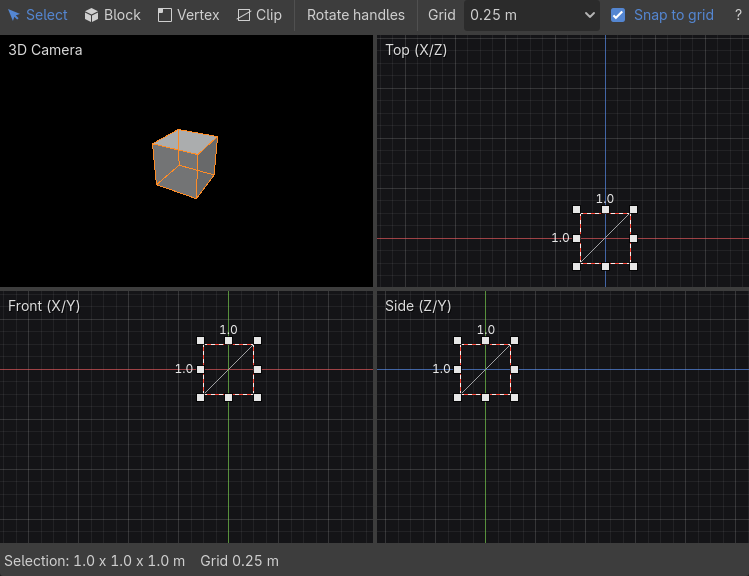

### Block
**Key:** Shift+B

Drag a box in a 2D view; Enter makes the shape.


### Clip
**Key:** Shift+X

Draw a line; Enter cuts the selected meshes.

### Maximize View
**Key:** Shift+Z

## Settings

Editor -> Editor Settings -> Hewn.

- **Interface -> Hotkeys** - Hewn's keys on / off.
- **Interface -> Last Operation Panel** - the Last Operation panel.
- **Interface -> Quad View** - the Quad view.
- **Interface -> Toggle On Color** - the background of the header and tool buttons that are on.
- **Interface -> Wrap Cursor At Viewport Edges** - when dragging, the mouse comes out at the other side of the viewport.
- **Warnings -> Subdivide Face Limit** - how many faces a subdivision may add without asking.

The keys are changed in Editor -> Editor Settings -> Shortcuts, the "hewn" section.
