# Документация Hewn

Hewn - это плагин для Godot 4.7, который позволяет создавать и редактировать меши и уровни для игр в редакторе Godot.

## Установка

1. Скачайте [последнюю готовую сборку](https://github.com/haker2377/hewn/releases) или [соберите плагин из исходного кода](#сборка).
2. Скопируйте папку `addons` в корневую папку проекта.
3. Включите плагин в Project -> Project Settings -> Plugins.

## Сборка

```
git clone https://github.com/godotengine/godot-cpp
python -m pip install scons
scons platform=windows target=editor     # или linux / macos
```

Собранная библиотека кладётся в `project/addons/hewn/bin/`.

# Использование

## Создание объекта

### Меню добавления
**Клавиша:** Shift+A

Меню всего, что можно добавить в сцену: меши, кривые, свет, камера, звук, картинки, декали, вырезы, физика (Area3D,
статичное тело, одна форма столкновений: рисуются как коробка). То же меню открывает кнопка «+» на верхней панели Hewn.
«Избранное»: сцены, добавленные в избранное (ПКМ по сцене в доке «Сцены» или избранное файловой системы Godot); пункт
есть, только если они есть.

Если в меню включено "Создавать в 3D-курсоре", объект появляется в 3D-курсоре с размерами по умолчанию.
Если выключено, фигуру нужно нарисовать мышью.

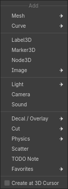

### Рисование фигуры

Клик ставит первый угол основания, второй клик - противоположный угол, третий - высоту. Можно и тянуть мышью.
У круглых фигур первый клик ставит центр.

- Shift при первом клике - основание под углом: первая сторона задаёт направление.
- Ctrl до первого клика - рисовать на продолжении плоскости грани под курсором.
- Alt - рисовать на плоскости прошлой фигуры.
- Q / E или R - повернуть фигуру с направлением (лестница, дверь, призма, клин).
- Высоту некоторых фигур можно ввести числом с клавиатуры.
- Enter вместо рисования - фигура стандартного размера в 3D-курсоре.

После создания слева внизу открывается панель параметров фигуры. Она будет открываеться снова при выделении фигуры, если её
геометрию не меняли в режиме редактирования.

Если рисовать фигуру в режиме редактирования, она добавляется в редактируемый меш.
### Фигуры

- **Куб**
- **Плоскость**
- **Цилиндр**
- **Конус**
- **Сфера**
- **Икосфера**
- **Тор**
- **Труба**
- **Призма**
- **Лестница**
- **Арка**
- **Дверной проём**
- **Капсула**
- **Диск**
- **Клин**
- **Колонна**

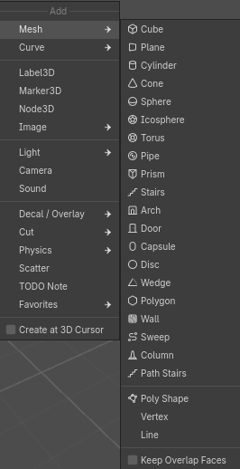

#### Коробка

**Клавиша:** B

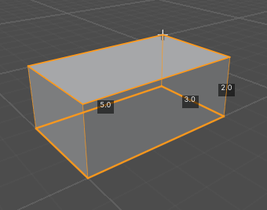

#### Плоскость

Плоскость по двум точкам.

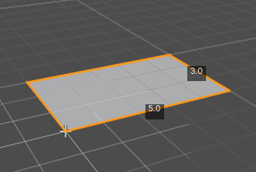

#### Цилиндр

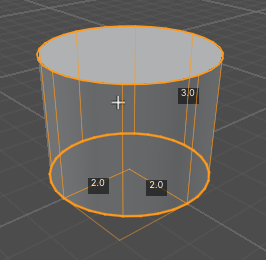

#### Конус

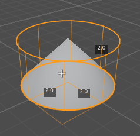

#### Сфера

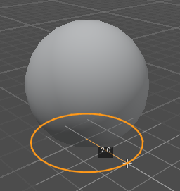

#### Икосфера

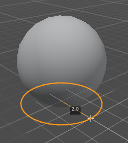

#### Тор

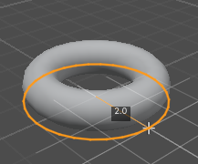

#### Труба

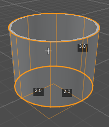

#### Призма

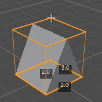

#### Лестница

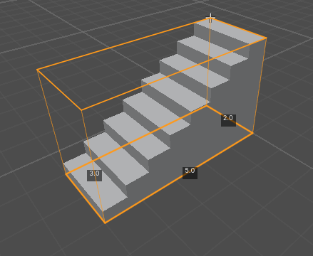

#### Арка

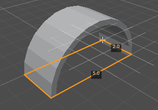

#### Капсула

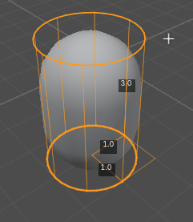

#### Диск

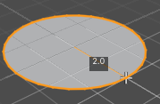

#### Клин

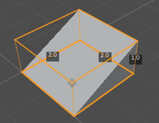

#### Стена

Стена по линии. Клики ставят углы, Enter, ПКМ или двойной клик - готово, Backspace убирает последний угол.

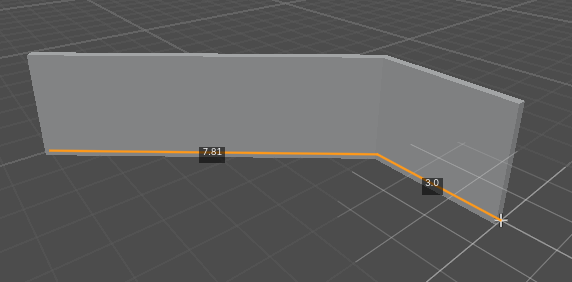

#### Колонна

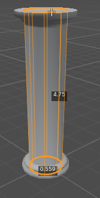

#### Протяжка

Профиль вдоль линии: перила, бордюры, трубы, карнизы. Рисуется так же, как стена.

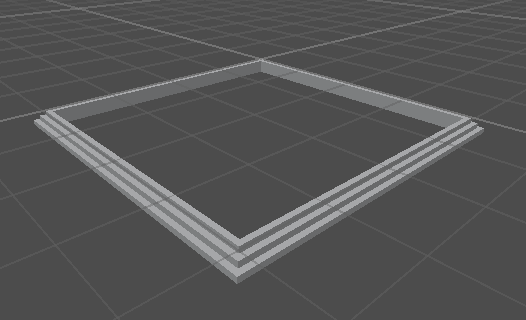

#### Лестница по точкам

Лестница вдоль линии: пролёты на отрезках, площадки на поворотах. Рисуется так же, как стена.

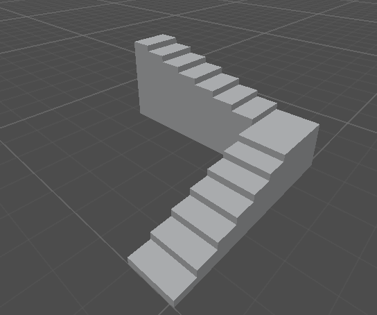

#### Полифигура

Контур по точкам с высотой. Клики ставят точки, клик по первой точке или Enter замыкает контур, затем мышью задаётся
высота.

После создания полифигуры точки можно поменять кнопкой "Изменить точки основания" в панели параметров: тянуть точку - двигать, клик по точке - удалить, клик по ребру - добавить.

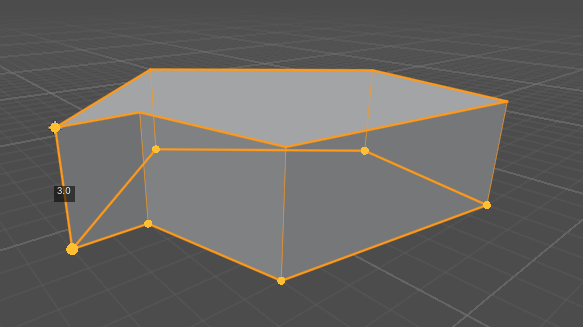

## Режимы

Режимы можно переключать на верхней панели Hewn.

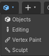

### Режим редактирования
**Клавиша:** Tab

Включает и выключает правку вершин, рёбер и граней выделенных мешей.

### Вершины, рёбра, грани
**Клавиши:** 1 / 2 / 3

Что выделяется в режиме редактирования. 
Shift+1 / 2 / 3 или Shift+клик по кнопке режима включает несколько сразу.

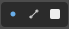

## Выделение

### Выделить
**Клавиши:** ЛКМ

Shift+клик добавляет к выделению или убирает из него.

### Петля
**Клавиши:** Alt+клик, двойной клик

Выделяет петлю рёбер или граней.

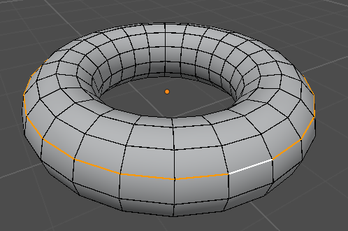

### Кольцо
**Клавиша:** Ctrl+Alt+клик

Выделяет кольцо рёбер или граней.

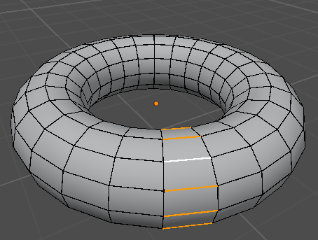

### Кратчайший путь
**Клавиши:** Ctrl+клик, Ctrl+Shift+клик

Ctrl+клик выделяет элементы между выделенным и кликнутым. 

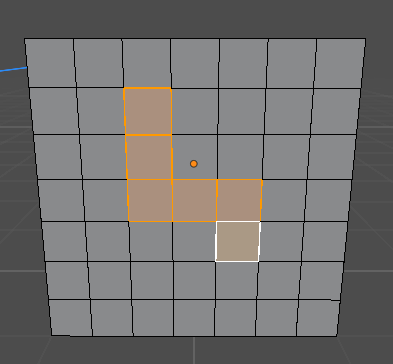

Ctrl+Shift+клик выделяет все кратчайшие пути между ними:
на сетке это весь прямоугольник.

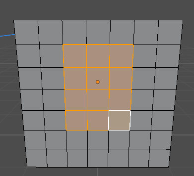

### Всё / Ничего / Инвертировать
**Клавиши:** A / Alt+A / Ctrl+I

### Расширить / Сузить
**Клавиши:** Ctrl+= / Ctrl+-

Добавляет к выделению соседние элементы или убирает крайние.

### Связанное
**Клавиши:** L / Ctrl+L

L выделяет связанную часть под курсором, Ctrl+L - связанную с выделенным.

### Граница

Выделяет открытые края меша: рёбра, у которых только одна грань.

### Шахматное снятие выделения

Снимает выделение с каждого второго элемента.

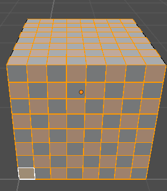

### Тот же материал / Та же нормаль

Выделяет грани с тем же материалом или с тем же направлением. У «Той же нормали» в панели последней операции есть
наибольший угол и «Только связанные».

### Неверные UV

Выделяет грани, у которых UV не имеют площади.

### Наложенные грани

Выделяет грани, лежащие друг на друге.

### Скрыть / Показать
**Клавиши:** H / Shift+H / Alt+H

Скрывает выделенные грани, остальные грани или показывает всё снова. Скрытые грани не видны только в режиме
редактирования.

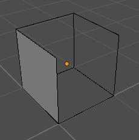

### Видимое выделение

Кнопка с глазом на верхней панели. Когда она включена, клики проходят сквозь грани, повёрнутые к камере изнанкой, и
комнату можно править снаружи.

Включено:

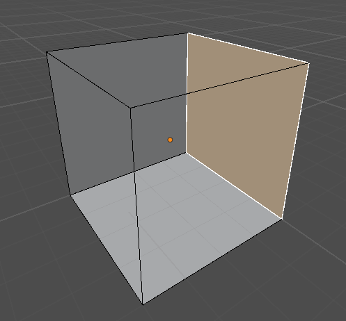

Выключено:

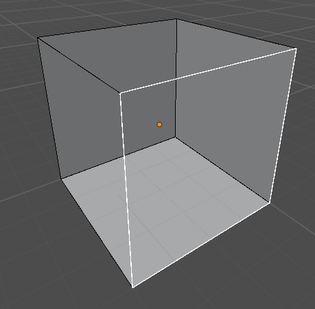

### Рентген
**Клавиша:** Alt+Z

Выделение проходит сквозь меш.

## Перемещение, вращение, масштаб

### Переместить / Повернуть / Масштабировать
**Клавиши:** G / R / S

Работает с выделенными элементами в режиме редактирования и с выделенными объектами в режиме объектов.

- X / Y / Z - ось, Shift+X / Y / Z - плоскость, второе нажатие - локальная ось.
- Значение перемещения можно ввести с клавиатуры.
- Ctrl - инвертирует привязку.
- Shift - замедляет изменение значения от движения мыши.
- ЛКМ или Enter - применить, ПКМ или Esc - отмена.

### Скольжение
**Клавиши:** G G

Выделенные элементы скользят вдоль рёбер. 
C - блокирует перемещение элементов на прямой текущего ребра.

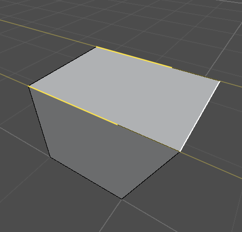

### Базовая точка
**Клавиша:** B (во время G / R / S и G G)

Клик - точка, откуда, второй клик - куда. Перемещает, поворачивает или масштабирует по этим точкам.

### Сдвиг стрелками
**Клавиши:** стрелки, Page Up / Page Down

Сдвигает выделение на шаг сетки по оси мира, ближайшей к виду. С Ctrl в режиме объектов сдвигается копия.

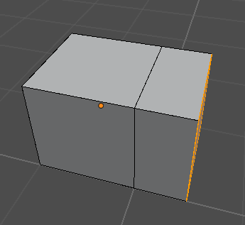

### Поворот стрелками
**Клавиши:** Alt+стрелки, Alt+Page Up / Page Down

Поворачивает выделение на 90°.

### Гизмо
**Клавиша:** W

Переключает гизмо: перемещение, поворот, масштаб, без гизмо.

### Ориентация

Меню на верхней панели: глобальная, локальная, нормаль, шарнир, вид, курсор, родитель. Пункт «Создать из выделения»
добавляет свою ориентацию по выделенному.

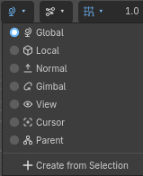

### Центр трансформаций

Меню на верхней панели: центр габаритов, 3D-курсор, индивидуальные центры, средняя точка, активный элемент.

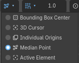

### Пропорциональное редактирование
**Клавиши:** O / Alt+O

Вместе с выделенным двигаются соседние элементы, тем меньше, чем дальше. Alt+O - только связанные. 

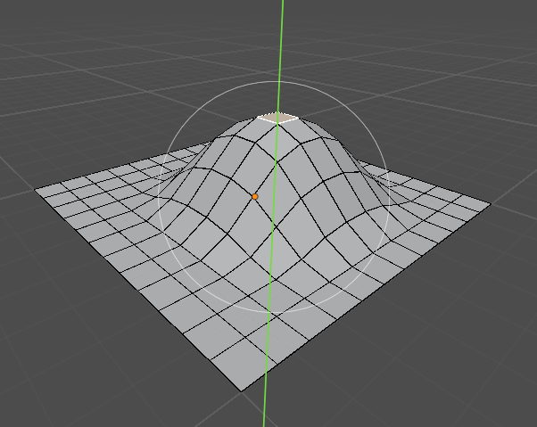

### Автослияние

Кнопка на верхней панели. Вершины, оказавшиеся рядом после перемещения, сливаются.

## Привязка

### Привязка
**Клавиши:** Y, Shift+Tab

Включается магнитом Godot. В меню привязки на верхней панели выбирается, к чему привязывать: шаг, сетка, вершина,
ребро, грань, центр ребра, центр грани.

### Шаг сетки
**Клавиши:** `[`, `]`

Делает шаг сетки вдвое меньше или больше. Текущий шаг виден рядом с меню привязки.

### 3D-курсор
**Клавиши:** Shift+ПКМ, Shift+S

Shift+ПКМ ставит 3D-курсор на поверхность. Shift+S - меню курсора: к выделенному, к началу координат, выделенное к
курсору.

## Вид

### Затенение

Шейдер, используемый в 3д вьювпорте.

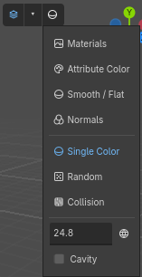

### Наложения

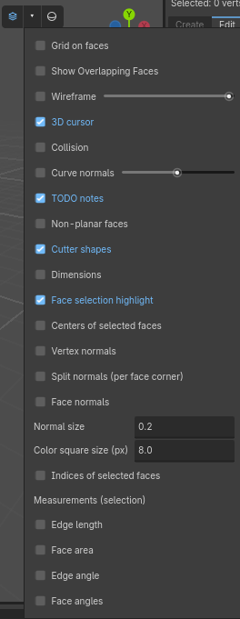

## Вершины

Меню Меш -> Вершина.

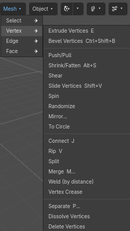

### Выдавить вершины
**Клавиша:** E

Выдавливает вершины в новые рёбра.

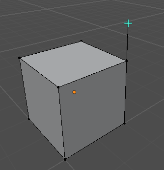

### Фаска вершин
**Клавиша:** Ctrl+Shift+B

Срезает углы в выделенных вершинах.

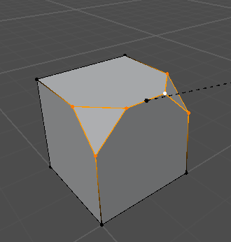

### Толкать/Тянуть

Двигает вершины к центру выделения или от него.

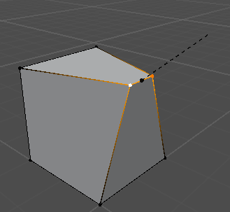

### Сжать/Раздуть
**Клавиша:** Alt+S

Двигает вершины вдоль их нормалей.

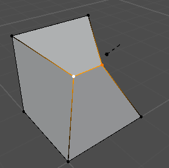

### Скос

Скашивает выделение.

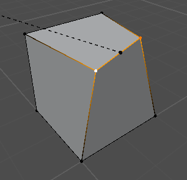

### Скольжение вершин
**Клавиша:** Shift+V

Двигает вершину вдоль одного из её рёбер.

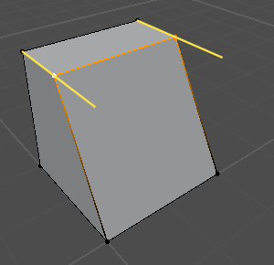

### Случайно

Сдвигает вершины на случайное расстояние.

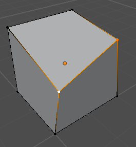

### Отразить

Отражает выделенное по оси.

### В окружность

Ставит выделенные вершины на окружность.

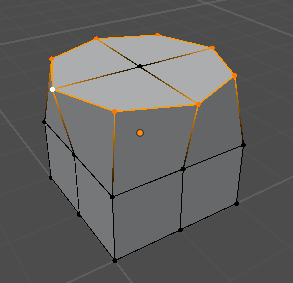

### Соединить
**Клавиша:** J

Соединяет выделенные вершины рёбрами через грани.

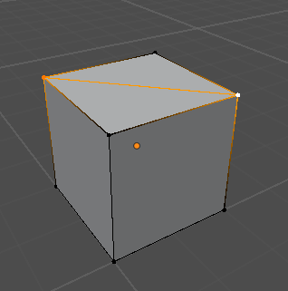

### Разорвать
**Клавиша:** V

Отрывает выделенное со стороны курсора и двигает.

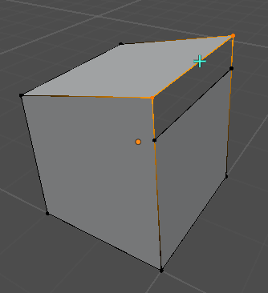

### Объединить
**Клавиша:** M

Сливает выделенные вершины: в центр, в курсор, к первой, к последней, по расстоянию.

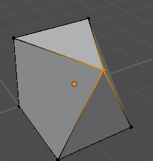

### Объединить по расстоянию

Сливает вершины, стоящие ближе заданного расстояния.

### Складка вершины

Вершина остаётся острой при подразделении.

### Разделить
**Клавиша:** P

Переносит выделенное в новый меш. Можно разделить и по материалу или по несвязанным частям.

### Растворить вершины
**Клавиша:** Ctrl+X

Убирает вершины, соседние грани сливаются.


### Удалить вершины
**Клавиши:** X, Delete

Удаляет вершины и грани у них.

## Рёбра

Меню Меш -> Ребро.


### Выдавить рёбра
**Клавиша:** E

Выдавливает рёбра в новые грани.


### Фаска рёбер
**Клавиша:** Ctrl+B

Срезает рёбра. Колесо или +/- меняет число сегментов.


### Мост между петлями рёбер

Соединяет две петли рёбер гранями.

### Протяжка по рёбрам

Протяжка (карниз) вдоль выделенных рёбер, снаружи граней рядом с ними. В режиме граней - по краю выделенных граней.


### Стена по рёбрам

Стена на выделенных рёбрах: парапет, ограда. Высота, толщина и сторона потом в панели фигуры.


### Новая грань из рёбер
**Клавиша:** F

Создаёт грань по выделенным рёбрам или вершинам. Две вершины - ребро между ними.

### Подразделить

Делит выделенные рёбра. Два противоположных ребра грани: их новые точки соединяются ребром. С выключенным «Создавать
N-угольники» соседние грани становятся четырёх- и треугольниками.


### Петлевой разрез и сдвиг
**Клавиша:** Ctrl+R

Режет петлю граней. Колесо - число разрезов, клик - разрез, потом мышью сдвиг, клик - применить.


### Скольжение со смещением
**Клавиша:** Ctrl+Shift+R

Добавляет рёбра по обе стороны выделенных и двигает их от середины.

### Соединить

Соединяет середины выделенных рёбер.


### Вставить петлю

Вставляет петлю через выделенное ребро.


### Арка из рёбер

Выгибает выделенные рёбра дугой. Два противоположных ребра потолка прохода дают свод.


### Повернуть ребро

Поворачивает ребро между двумя гранями.

### Вес фаски / Складка
**Клавиша:** Shift+E (складка)

Ребро со складкой остаётся острым при подразделении.

### Пометить шов / Убрать шов

Шов останавливает развёртку UV и продолжение текстуры.

### Пометить острым / Убрать остроту / Острота по углу

На остром ребре нормали гладких граней разделяются.

### Разъединить

Разрывает меш по выделенным рёбрам.

### Растворить рёбра
**Клавиша:** Ctrl+X

Убирает рёбра, грани по обе стороны сливаются.

### Удалить рёбра / Удалить петли рёбер

## Грани

Меню Меш -> Грань.


### Выдавить грани
**Клавиша:** E

Выдавливает грани вместе. Alt+E - меню других вариантов.


### Выдавить вдоль нормалей

Каждая вершина уходит по своей нормали.

### Выдавить по отдельности

Каждая грань выдавливается сама по себе.

### Выдавить с повтором

Выдавливает выделение несколько раз подряд вдоль его нормали. В панели последней операции: повторы, расстояние и
масштаб за шаг.

### Вставка
**Клавиша:** I

Создаёт внутри граней грани поменьше.


### Прокрутить

Вращает копии выделенного шагами вокруг 3D-курсора.


### Ткнуть

Делит грань на треугольники с вершиной в центре.


### Мост между гранями

Соединяет две грани туннелем, сами грани удаляются.


### В окружность

Ставит край выделенных граней на окружность.

### Подразделить

Делит грани.


### Триангулировать

Делит грани на треугольники.


### Треугольники в четырёхугольники

Сливает пары треугольников.

### Объединить

Сливает выделенные грани в одну.
### Заполнить отверстие

Закрывает дыру гранью.

### Гладкое затенение / Плоское затенение

### Отразить нормали

Разворачивает грани.


### Пересчитать наружу / внутрь
**Клавиши:** Shift+N / Ctrl+Shift+N

Разворачивает все грани наружу или внутрь. Alt+N - меню нормалей.

### Отделить

Отрывает выделенные грани от соседних, они остаются в том же меше.


### Дублировать
**Клавиша:** Shift+D

Копирует выделенное и двигает копию.


### Растворить грани / Растворить по ограничению

Сливает грани. По ограничению - только те, что сходятся под малым углом.

### Удалить грани

### Перетаскивание грани
**Клавиша:** Shift+перетаскивание

Двигает грань вдоль её нормали, соседние грани тянутся. Ctrl+Shift+перетаскивание наружу выдавливает из грани
новый блок, внутрь - разрезает объект: протянутая часть становится отдельным объектом.

### Резак граней

Режет грань линиями от одного из её рёбер.


## Инструменты

Панель инструментов слева во вьюпорте.

### Выделение рамкой


### Линейка
**Клавиша:** Shift+M


Протяжка - новая линейка. Тянуть середину - угол. X или Delete над линейкой - удалить.


### Нож
**Клавиша:** K


Клики ставят точки, Enter режет. ПКМ заканчивает текущий разрез. A - шаг угла 30°, Ctrl - середина ребра.
Точка притягивается к вершинам, рёбрам и уже размеченным линиям ножа. Все разрезы делаются сразу: где разрезы
пересекаются, ставится вершина, каждая грань делится на куски без наложений.
### Петлевой разрез
**Клавиша:** Ctrl+R


### Вырезание рамкой


Рисует прямоугольник, круг или многоугольник на грани и вырезает его, режет по нему или выдавливает.

### Рассечь


В режиме редактирования: проведите линию через меш, плоскость через неё и взгляд режет выделенное. В панели: «Только
разрезать», «Разрезать и заполнить» (две замкнутые части), «Удалить сверху», «Удалить снизу» («Заполнить отверстие»).
Стрелка на плоскости двигает её, два кольца поворачивают (Ctrl - привязка). «Разрезать и заполнить»: обе части
замкнуты, нижняя - отдельный объект («Отделить отрезанное»).

### Отсечение
**Клавиша:** Alt+X


Отдельный инструмент (ножницы в колонке инструментов), в режиме объектов и редактирования: клики ставят 2 или 3 точки,
плоскость через них режет, Ctrl+Enter - что оставить, Enter - применить.

### Прокрутить


Кольцо вокруг 3D-курсора: тянуть его - выделение вращается вокруг оси. X / Y / Z / V - ось.

## Инструменты уровня

### Вырез коробкой / цилиндром / призмой
**Клавиша:** C (коробкой)

Рисуется как фигура и вырезает объём из мешей. Работает на редактируемом меше, на выделенных объектах или на всей
сцене.


## Объекты

Меню Объект.

### Применить трансформацию

Переносит положение, вращение и масштаб в вершины.

### Центр к геометрии / к 3D-курсору / к выделению

Двигает центр объекта, геометрия остаётся на месте.

### Подразделить (Катмулл-Кларк)

Сглаживает меш подразделением.


### Ремеш

Вкладка «Объект» на панели Hewn. Строит выделенные меши заново, их форма при этом сохраняется. Меш должен быть
замкнутым.
- «Воксель»: грани размером с воксель. Адаптивность уменьшает число граней на плоских участках, «Исправить полюса»
  выравнивает вершины вдоль поверхности. Можно сохранить объём и атрибуты (цвета вершин, сглаживание).


- «Квад»: четырёхугольники нужной плотности: по числу граней, по соотношению к нынешнему числу граней или по длине
  ребра (примерное число граней показывается). Вариация сдвигает сетку. Сетка идёт вдоль осей, а не по изгибам формы.


### Коллизия

Группа «Коллизия» в инспекторе меша Hewn. Типы:
- Trimesh


- Convex


- Simplified Convex


- Multiple Convex


- Box


- Capsule


- Cylinder


- Sphere


- Simplified Trimesh


«Метаданные» и «Группы» ставятся на меш и тело коллизии при запекании.
Collision Layer и Collision Mask в разделе коллизии задают слои тела при запекании.

### Автосглаживание

Гладкое затенение с острыми рёбрами по углу.

### В четырёхугольники

Сливает треугольники всего меша в четырёхугольники.

### Согласовать нормали / Триангулировать всё / Отразить все нормали

### Применить модификаторы

Переносит результат модификаторов в сам меш.

### Объединить выделенные объекты

**Клавиша:** Ctrl+J

### Удалить внутренние грани

Удаляет грани, которые никак не увидеть: внутри тела после объединения пересекающихся или касающихся объектов.
Внутренность комнаты (грани повёрнуты внутрь) остаётся. В режиме редактирования «Выделение -> Внутренние грани»
только выделяет их. Лишние рёбра на плоских участках потом убирает «Растворить по ограничению».

### Булево объединение / разность / пересечение


### MeshInstance3D -> Hewn

Переводит обычный меш (или CSG) в меш Hewn.

### Запечь в MeshInstance3D

Делает из выделенных мешей и кривых Hewn обычный MeshInstance3D.

### Экспорт OBJ / Экспорт glTF

Сохраняет выделенный меш в файл (glTF или FBX).

### Меню объекта
**Клавиша:** ПКМ

В режиме объектов: центр, курсор к выделенному, затенение, нормали, дублировать, удалить, очистить и применить
трансформацию.


### На пол / к потолку

Выделенные объекты прямо вниз (или вверх), пока не коснутся: мешем или ориджином; «По нормали поверхности»
поворачивает их по ней. Панель слева снизу.


### Размещение физикой

Выделенные объекты падают на то, что вокруг, и успокаиваются. Их можно таскать левой кнопкой. «Применить» (Enter)
оставляет их там одним шагом отмены, «Отмена» (Esc) возвращает. Гравитация в панели.

### Преобразовать в коллизию

Выделенные меши как формы столкновений по их форме: выпуклая, Trimesh, куб, сфера, капсула, цилиндр; в статичном теле
(по умолчанию), в Area3D или сами по себе; «Оставить меш» ставит тело под меш.

### Удалить
**Клавиша:** X

В режиме объектов удаляет выделенные узлы.

### Изолировать / Навести камеру
**Клавиши:** / , .

## Модификаторы

Модификаторы добавляются в инспекторе, в массиве Modifiers (Add Element). Работают сверху вниз, порядок меняется
перетаскиванием.

### HewnMirrorModifier

Отражает меш по осям или по плоскостям другого узла.


### HewnSolidifyModifier

Придаёт мешу толщину.

### HewnSubdivisionModifier

Сглаживает меш подразделением.


### HewnBooleanModifier

Объединяет, вычитает или пересекает меш с другими объектами. Объекты остаются операндами, их можно двигать.

### HewnArrayModifier

Копии меша по линии, по кругу или вдоль кривой. На кривой Hewn из нескольких сплайнов «На каждую кривую» даёт
количество каждому. «По длине кривой»: линия из стольких копий, сколько помещается в длину кривой. «Колпачки»: меш
перед первой копией и после последней.


### HewnCurveModifier

Изгибает меш вдоль кривой: «Ось деформации» идёт вдоль первого сплайна (от ориджина кривой), две другие поперёк, с
наклоном и радиусом кривой.


### HewnRemeshModifier

Строит меш заново на сетке вокселей: Blocks (кубики), Smooth (сглаженно), Sharp (острые углы сохраняются, их
степень задаёт Sharpness) или Voxel (по размеру вокселя). Для первых трёх размер ячейки задают Octree Depth и Scale.
Remove Disconnected убирает мелкие отдельные куски, Smooth Shading включает гладкое затенение.

### HewnSimplifyModifier

Упрощает меш. «Схлопнуть» (Collapse) оставляет долю треугольников по соотношению (Ratio), «Планарно» (Planar)
объединяет соседние грани, которые сходятся под углом меньше предела (Angle Limit).

## Текстуры

### Док «Текстуры»

Картинки проекта. Клик по картинке кладёт её на выделенные грани, в режиме объектов - на выделенные объекты. Картинку
можно перетащить на грань или объект.

Материал для картинки создаётся один раз в папке материалов и потом берётся снова.


### Перенос текстуры
**Клавиши:** Alt+клик, Ctrl+Alt+клик, Alt+ПКМ

Когда выделена одна грань, Alt+клик переносит её текстуру на другие грани, узор продолжается через рёбра.
Ctrl+Alt+клик переносит только UV. Alt+ПКМ берёт текстуру с кликнутой грани.

### Текстура к ребру
**Клавиша:** T

Прижимает текстуру к ребру под курсором. W / A / S / D - какой стороной, Q - вписать по высоте, E - по ширине, R -
масштаб 1. Клик, Enter или T - применить, Esc - отмена.


### Трансформация текстуры
**Клавиша:** Shift+T

Показывает плитку текстуры на выбранной грани с ручками: углы и стороны - масштаб, центр - сдвиг, кружок - поворот.
G / R / S - то же мышью без ручек. Клик мимо ручек или Enter - применить, Esc - отмена.


### Инструменты текстуры
**Клавиша:** U

Те же инструменты, что во вкладке UV, меню под курсором. В пунктах «Двигать / Вращать / Масштабировать текстуру»
текстура следует за мышью: X / Y - ось, Ctrl - шагами.

- **Цикл** - поворот на четверть.
- **Отразить U / V**
- **Вписать по U / V** - одна плитка по ширине или высоте.
- **По центру**, **Вписать в грань**, **Случайный сдвиг**
- **Кубическая проекция**
- **Продолжить от активной** - текстура последней выделенной грани идёт на остальные.
- **Развёртка квадами в плитку** - полоса четырёхугольников раскладывается в одну плитку.
- **Копировать / Вставить UV-прямоугольник**

### Мировые UV

Текстура берётся по положению грани в мире: соседние объекты стыкуются без швов. Во вкладке UV включается для новых
объектов, кнопка «Применить мировые UV» переводит выделенное. Острова UV остаются у первого тайла, даже если объект
далеко от центра сцены.

Текстура проецируется вдоль ближайшей оси мира, поэтому на наклонных гранях она растянута. «Выровнять по грани»
проецирует её на плоскость выделенных граней в настоящем размере (со соседями может появиться шов), «Выровнять по
оси» возвращает как было.

### Блокировка UV

Грани, которые двигают в режиме редактирования, уносят текстуру с собой.

### Вкладка «Материал»

Материалы меша и настройки текстуры выделенных граней: фильтрация, прозрачность, цвета вершин, шероховатость,
металличность.


### Служебные материалы

Материал «Отсечение» не рисуется в игре, но даёт коллизию. Им делают невидимые стены.

### UV2 для лайтмапов

Вкладка Объект -> Игра. Строит вторую развёртку для запекания света.

## UV-редактор

Док «Hewn UV». Показывает UV выделенных граней поверх текстуры.

- 1 / 2 / 3 - вершины, рёбра, грани UV.
- Клик, Shift+клик, рамка - выделение. L - остров под курсором, Ctrl+L - острова выделенного.
- G / R / S или перетаскивание - перемещение, поворот, масштаб.
- Ctrl+P - упаковать острова, Ctrl+A - выровнять их масштаб.
- Колесо - масштаб вида, средняя кнопка - сдвиг.


## Скульптинг


Режим выбирается в меню в начале верхней панели. Подходит для небольшого террейна и мягких форм. ЛКМ - мазок, весь
мазок отменяется одним Ctrl+Z. Ctrl - кисть в другую сторону, Shift - сглаживание в любой кисти. Ctrl+колесо или
[ / ] - радиус, Shift+колесо - сила. Если в режиме редактирования что-то выделено, лепится только выделенное.

Инструменты в колонке слева:
- Поднять / опустить.
- Сгладить.
- Выровнять - к плоскости под кистью, с Ctrl - к высоте, где начат мазок.
- Тянуть - захваченная область идёт за мышью.
- Шум.
- Ступени - высоты округляются до шага (поле «Шаг» на панели).
- Сжать, раздуть.
- Резкий край - канавка, с Ctrl - гребень.
- Плотность - только меняет детализацию (виден при включённой динамической топологии).

На панели: радиус в пикселях, сила, направление («Вверх» - строго вверх, склоны не загибаются; «По нормали» - из
поверхности под кистью, по умолчанию), спад (как у раскраски вершин и «Особая» со своей кривой), нажим пера (на
силу и на радиус) и курсор (на экране или на поверхности, его цвет).

### Динамическая топология

Галочка на панели. Под кистью поверхность делится на треугольники нужного размера: длинные рёбра делятся, короткие
схлопываются. Метод уточнения: подразделять, схлопывать или и то и другое. Детализация: относительная (в пикселях на
экране), постоянная (в метрах) или детализация кисти (в процентах от радиуса).

## Раскраска вершин


Режим выбирается в меню в начале верхней панели. Красятся вершины, рёбра или грани (1 / 2 / 3), а если что-то
выделено - только выделенное.

### Кисть


ЛКМ рисует. Ctrl+колесо - радиус, Shift+колесо - сила, Ctrl+клик - взять цвет.

### Карандаш


Красит одну вершину.

### Заливка


Красит выделенное или связанную часть.

### Пипетка


Берёт цвет. С Shift - во второй цвет.

### Нормали


ЛКМ делает нормали гладкими, Ctrl+ЛКМ - плоскими.

### Цвета
**Клавиши:** X, D


X меняет местами два цвета, D сбрасывает их на чёрный и белый.

### Запечь свет

Меню «Цвета» или Объект -> «Запечь свет в цвета вершин». Записывает в цвета вершин свет и тени от источников
сцены.

### Материал смешивания

Вкладка «Материал». Смешивает до четырёх текстур по цвету вершин. Флажки окна добавляют каждой текстуре
металличность и шероховатость, карту нормалей, карту затенения (AO), свечение. Их значения задаются в инспекторе. «Прокрутка»: текстуры
движутся (угол и скорость прокрутки), со своим шейдером.
- Маска шума: границы между текстурами рвутся по шуму, у каждого слоя своя сила, масштаб и мягкость шума общие.
- Подъём по закраске: слой поднимает вершины вверх на заданную высоту там, где он закрашен (снег). Коллизия не меняется,
  а подъём виден только на достаточно плотной сетке.

### Прокручивающийся материал

Вкладка «Материал» -> «Прокручивающийся материал»: изображение (материала выделенного или последней выбранной
текстуры) движется по граням (вода, конвейер). Направление и
скорость в инспекторе; свой шейдер, обычные материалы не меняются.

## Сцены и объекты

### Док «Сцены»

Клик по сцене - сцена следует за курсором, отпускание ставит её. Q / E - поворот на 90°, N - по нормали поверхности,
R - другой случайный поворот. «Размещение...» - случайный поворот и размер. ПКМ по сцене: добавить в избранное
(Shift+A -> Избранное) или показать в файловой системе.
### Сущности

Вкладка «Создание». Свет, прожектор, звук и свои объекты из `res://hewn_entities.json`.

### Декали и оверлеи

Картинка на поверхности. Декаль - узел Decal Godot. Оверлей ложится на грани Hewn и сохраняется как геометрия.
- / = во время размещения меняют размер.

Угловые точки оверлея можно тянуть мышью прямо во вьюпорте, картинка искажается вслед за ними. В инспекторе, в разделе Shape:
- Control Points: 4 точки или 9 (с ними можно изгибать края).
- Reset Shape: вернуть прямоугольник.


### Изображение-референс

Shift+A -> Изображение. Картинка для обрисовки, в игре не видна.

### Рассеивание

Shift+A -> Рассеивание. Копии мешей, нарисованные на поверхностях: трава, камни, кусты. В инспекторе: меши и их веса,
плотность, радиус кисти, случайный поворот (и вокруг X и Z), наклон и масштаб, «Базовый поворот» (для меша,
смоделированного лёжа), «Выравнивание» (вверх или по нормали поверхности), смещение. «Коллизии»: для каждого меша
(выпуклая, треугольная сетка, прямоугольник), создаются при запуске и запекании. Пока узел выделен, его кисти в колонке
инструментов:
- Кисть: добавляет копии. Ctrl - стереть, Shift - проредить.
- Стереть, Проредить.
- Ctrl+колесо или [ / ] - радиус.

Пока он выделен, открывается его нижняя панель: меши (Ctrl / Shift - несколько; кисть ставит выбранные, если ни одного -
все), «Добавить меш», «Убрать», «Все» / «Ничего», «Сила стирания» (меньше 1 - ластик прореживает) и настройки кисти
(плотность, радиус, масштаб, поворот, наклон, отступ). Tab выходит из кисти, как Esc.

Копии хранятся по чанкам («Размер чанка»), каждый рисует свой MultiMeshInstance3D с «Дальностью видимости». Мазок
перестраивает только задетые чанки. При запекании получаются обычные узлы MultiMeshInstance3D.


### Запекание уровня

Bake Level сначала открывает окно настроек, затем спрашивает файл. Настройки сохраняются в проекте и применяются также при экспорте игры.
- Окклюдеры: для крупных непрозрачных мешей. Работают только при включённом отсечении окклюдерами в настройках проекта, окно предупредит, если оно выключено.
- Объединять статичные меши: мелкие объекты с одинаковыми метаданными, группами и настройками отрисовки объединяются по участкам карты.
- Делить большие меши: детализированные меши крупнее заданного размера (по умолчанию 128 м) режутся на участки этого размера.
- Обе настройки не трогают объекты со скриптом, под движущимся родителем, с lightmap UV2. Для отдельного объекта - Merge At Bake в инспекторе.
- Также обычные меши: по умолчанию MeshInstance3D не из Hewn не объединяются и не делятся.
- Объединять коллизии, Уровни детализации (LOD), Дальность видимости по размеру, Убирать скрытые грани.

Запустить запечённым (Run Baked): уровень в том виде, как после экспорта. F5 запускает редактируемые узлы без запекания.

У мешей, кривых, рассеивания и объектов вдоль кривой есть метаданные, группы и скрипты для игровых узлов. Скрипт объекта наследуется от MeshInstance3D (меш) или Path3D (кривая), скрипт коллизии от StaticBody3D.

### Дороги и мосты

Shift+A -> Кривая -> Дорога (оверлей на земле), Дорога (меш на земле) или Мост. То же самое можно включить у любой кривой: раздел Road в инспекторе. Текстура назначается кликом по ней при выделенной кривой. Поперёк дороги картинка укладывается один раз, вдоль повторяется.
- Mode: выключено, меш или оверлей.
- Width: ширина.
- Repeat: длина одного повтора картинки вдоль дороги (0 - по её пропорциям).
- Reach: как далеко под кривой искать поверхность.
- Step: как часто вдоль дороги проверять высоту.

Оверлей ложится на самую верхнюю поверхность под кривой и обновляется при её правке, новых вершин в меше не появляется. Softness задаёт мягкость краёв в метрах, Order - какая дорога окажется сверху при наложении. Edge Noise делает мягкий край рваным: по шуму размером Edge Noise Size и по яркости текстуры дороги (Edge Height) или по своей карте высот.

Меш идёт ровно по кривой, а с включённым Snap опускается на поверхность под ней. Его настройки: сегменты поперёк, толщина, высота и ширина бордюров, подъём над землёй. У моста сразу есть бордюры, коллизия и опоры, которые расставляются вдоль кривой. Side Material задаёт отдельный материал для бортов, бордюров и низа, Bottom выключает нижнюю грань.


### Кривые

Shift+A -> Кривая: Безье, окружность, NURBS-кривая, NURBS-окружность, Path3D, верёвка. Кривая Hewn - это Path3D
(PathFollow3D работает с её первым сплайном) из нескольких сплайнов: полилиния, Безье или NURBS, с радиусом и наклоном
в каждой точке. В инспекторе: «Разрешение», «2D» (в плоскости XZ, «Заполнение» заливает замкнутые), «Смещение»,
«Выдавливание», «Объект сужения», фаска («Круг» с глубиной и разрешением, «Объект» - форма другой кривой, «Профиль» -
четверть, повёрнутая по кругу), «Заполнить края», материал, коллизия. В игре это обычный Path3D со своим мешем.

Tab - правка точек:
- Клик / Shift / рамка: выделение, A / Alt+A, Ctrl+I. Ручку можно тянуть мышью или кликнуть, чтобы двигать её на G / R / S.
- G / R / S, X / Y / Z (повторно - локально), Ctrl - привязка, Shift+Tab - привязка вкл / выкл, B - от точки к точке.
- Alt+S - радиус, Ctrl+T - наклон, Alt+T - очистить наклон.
- E - экструдировать: после конца новая точка, выделенный участок в середине вытягивается, на его границах появляются новые точки. F - создать сегмент (соединить два конца
  или замкнуть сплайн). Ctrl+клик - точка под курсором. Shift+D - дублировать.
- V - тип ручки, Alt+C - замкнутость, Shift+N - пересчитать ручки, P - отделить, Ctrl+X - растворить, X - удалить.
- ПКМ - меню: подразделить, рисовать (штрих в плоскости 3D-курсора или по поверхности), сгладить (положение, наклон,
  радиус), упростить, задать радиус / целевой вес, отразить, привязка, тип сплайна, направление, разделить.

ПКМ в режиме объектов: в меш, ориджин, дублировать, отразить, привязка. То же есть в меню «Кривая» на верхней панели,
пока кривая выделена. «Меш -> кривая» (Конвертация) и «Создать из рёбер» (меню рёбер) делают кривые из рёбер. Клик по
любому месту кривой выделяет её. В режиме правки она снята с выделения (нет гизмо); Esc выходит, как Tab; Ctrl+клик
по сплайну выделяет все его точки; во время G / R / S можно ввести число (S Y 0), Shift+X / Y / Z - все оси, кроме
этой; R дважды - трекбол; точки привязываются к точкам кривых. Инструмент «Рисовать» - в колонке инструментов, пока
кривая редактируется.

«Размещения» (инспектор): меши вдоль неё, каждый - MultiMesh: по центру, слева, справа или с обеих сторон («Отступ»),
сколько помещается («Шаг» 0 - по длине меша) или через заданное расстояние, случайно («Случайность шага»,
«Вероятность», «Разброс», масштаб, поворот), участками («Длина участков», «Доля участков»), на землю под ними, с
коллизией.

«Покраска вершин» (инспектор): меши под ней окрашиваются (цвет или CUSTOM0..3, ширина, спад, сила, высота): дорожка с
материалом смешивания. Видно и запекается, но не сохраняется в меше: отодвиньте - цвета вернутся.

### Верёвка

Shift+A -> Кривая -> Верёвка. 


### Запечь навмеш

Вкладка Объект -> Игра или меню «Объект»: обычный NavigationMesh выделенных объектов (ничего не выделено - всей сцены),
его настройки в окне как у Godot (по умолчанию по тому, что сталкивается), сохраняется в файл; по желанию в сцену
добавляется NavigationRegion3D с ним. После изменений уровня запекается заново так же.

### Заметка TODO

Shift+A -> Заметка TODO: заметка в месте уровня (что здесь планируется); её текст в панели. В игре её нет.


## Игра и экспорт

Вкладка Объект -> Игра.

### Запечь уровень

Сохраняет копию сцены для игры: обычные MeshInstance3D, коллизия, окклюдеры. Эта сцена остаётся редактируемой.

### Экспорт сцены в glTF

Сохраняет всю сцену одним файлом (glTF или FBX).

### Проверить сцену

Список проблем сцены: грани без площади, несваренные вершины, неплоские грани и другие. Большую часть можно исправить
оттуда же.

### Размер сцены

Показывает, что занимает место в сохранённой сцене.

## Экран Quad

Вкладка рядом с 2D / 3D. Сверху слева 3D-вид, остальные - сверху, спереди и сбоку.


### Блок
**Клавиша:** Shift+B

Растяните коробку в 2D-виде, Enter создаёт фигуру.


### Отсечение
**Клавиша:** Shift+X

Проведите линию, Enter режет выделенные меши.

### Развернуть вид
**Клавиша:** Shift+Z

## Настройки

Редактор -> Настройки редактора -> Hewn.

- **Interface -> Hotkeys** - клавиши Hewn вкл / выкл.
- **Interface -> Last Operation Panel** - панель последней операции.
- **Interface -> Quad View** - экран Quad.
- **Interface -> Wrap Cursor At Viewport Edges** - курсор при перетаскивании выходит с другой стороны вьюпорта.
- **Warnings -> Subdivide Face Limit** - сколько граней может добавить подразделение без вопроса.

Клавиши меняются в Редактор -> Настройки редактора -> Сочетания клавиш, раздел «hewn».