# Документация Hewn

Hewn - это плагин для Godot 4.7, который позволяет создавать и редактировать меши и уровни для игр в редакторе Godot.

## Установка

1. Скачайте [последнюю готовую сборку](https://github.com/haker2377/hewn/releases) или [соберите плагин из исходного кода](#сборка).
2. Скопируйте папку `addons` в корневую папку проекта.
3. Включите плагин в Project -> Project Settings -> Plugins.

## Сборка

```
git clone https://github.com/godotengine/godot-cpp
python -m pip install scons
scons platform=windows target=editor     # или linux / macos
```

Собранная библиотека кладётся в `project/addons/hewn/bin/`.

# Использование

## Создание объекта

### Меню добавления
**Клавиша:** Shift+A

Меню всего, что можно добавить в сцену: меши, кривые, свет, камера, звук, картинки, декали, вырезы, физика. То же
меню открывает кнопка «+» на верхней панели Hewn.

Если в меню включено "Создавать в 3D-курсоре", объект появляется в 3D-курсоре с размерами по умолчанию.
Если выключено, фигуру нужно нарисовать мышью.


### Рисование фигуры

Клик ставит первый угол основания, второй клик - противоположный угол, третий - высоту. Можно и тянуть мышью.
У круглых фигур первый клик ставит центр.

- Shift при первом клике - основание под углом: первая сторона задаёт направление.
- Ctrl до первого клика - рисовать на продолжении плоскости грани под курсором.
- Alt - рисовать на плоскости прошлой фигуры.
- Q / E или R - повернуть фигуру с направлением (лестница, дверь, призма, клин).
- Высоту некоторых фигур можно ввести числом с клавиатуры.
- Enter вместо рисования - фигура стандартного размера в 3D-курсоре.

После создания слева внизу открывается панель параметров фигуры. Она открывается снова при выделении фигуры, пока её
геометрию не меняли в режиме редактирования.

Если рисовать фигуру в режиме редактирования, она добавляется в редактируемый меш.
### Фигуры

- **Куб**
- **Плоскость**
- **Цилиндр**
- **Конус**
- **Сфера**
- **Икосфера**
- **Тор**
- **Труба**
- **Призма**
- **Лестница**
- **Арка**
- **Дверной проём**
- **Капсула**
- **Диск**
- **Клин**
- **Колонна**


#### Коробка


**Клавиша:** B


С галочкой "Комната" коробка полая. Пол и потолок: нет, сплошной (толщиной в стену) или плоский (одна грань внутрь).

#### Плоскость


Плоскость по двум точкам.

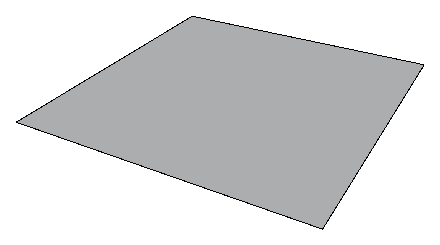

#### Цилиндр


#### Конус


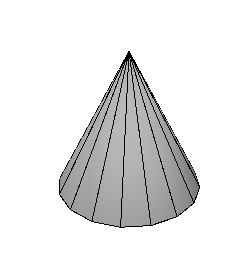

#### Сфера


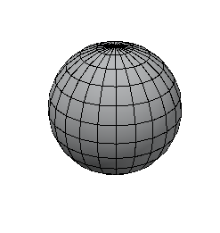

#### Икосфера


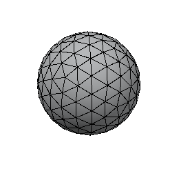

#### Тор


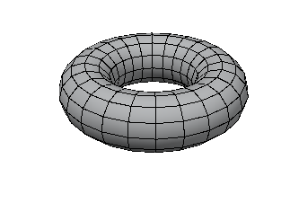

#### Труба


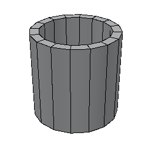

#### Призма


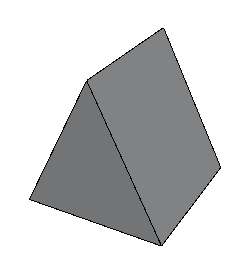

#### Лестница


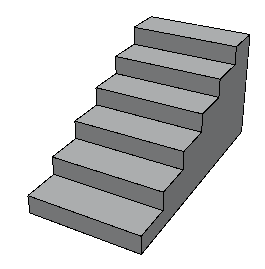

#### Арка


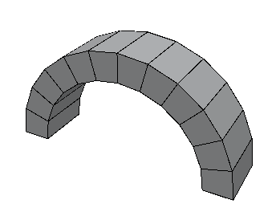

#### Капсула


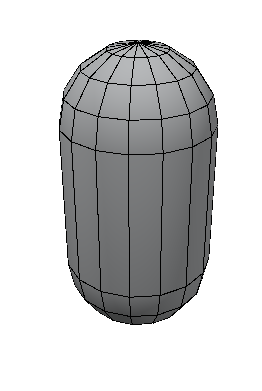

#### Диск


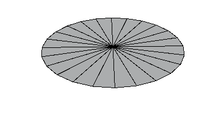

#### Клин


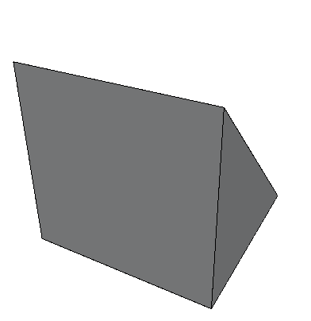

#### Стена


Стена по линии. Клики ставят углы, Enter, ПКМ или двойной клик - готово, Backspace убирает последний угол.

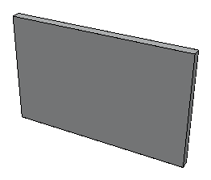

#### Колонна


#### Протяжка


Профиль вдоль линии: перила, бордюры, трубы, карнизы. Рисуется так же, как стена.

Кнопка "В виде" в панели параметров показывает точки профиля на фигуре: их можно тянуть, добавлять и удалять. Так же
у колонны, двери, арки, клина и крыши.


#### Лестница по точкам

Лестница вдоль линии: пролёты на отрезках, площадки на поворотах. Рисуется так же, как стена.

Колесо мыши при рисовании меняет число ступеней в марше. "Радиус углов" скругляет повороты.

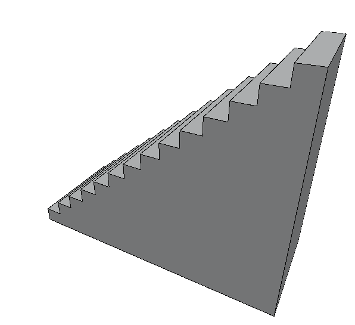

#### Полифигура


Контур по точкам с высотой. Клики ставят точки, клик по первой точке или Enter замыкает контур, затем мышью задаётся
высота.

После создания полифигуры точки можно поменять кнопкой "Изменить точки основания" в панели параметров: тянуть точку - двигать, клик по точке - удалить, клик по ребру - добавить.


#### Камень
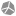

Шар, продавленный шумом, со сколами. Другое зерно - другой камень.

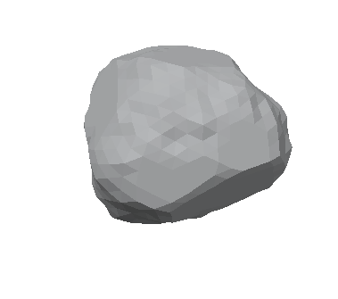

#### Текст
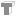

Объёмные буквы шрифта. Ставится кликом; текст, шрифт, размер и глубина - в панели параметров.

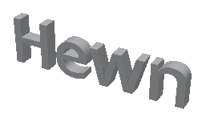

#### Крыша
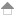

Крыша по контуру: вальмовая, двускатная, односкатная или плоская. Рисуется тремя кликами, как куб: два угла и высота
конька. Кнопка "Кривая" задаёт форму скатов. Одна крыша над Г- или Т-образным контуром сама соединяет скаты.

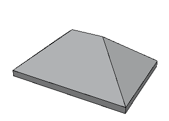

## Режимы

Режимы можно переключать на верхней панели Hewn.


### Режим редактирования
**Клавиша:** Tab

Включает и выключает правку вершин, рёбер и граней выделенных мешей.

### Вершины, рёбра, грани
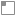 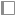 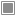\
**Клавиши:** 1 / 2 / 3

Что выделяется в режиме редактирования. 
Shift+1 / 2 / 3 или Shift+клик по кнопке режима включает несколько сразу.

## Выделение

### Выделить
**Клавиши:** ЛКМ

Shift+клик добавляет к выделению или убирает из него.

### Петля
**Клавиши:** Alt+клик, двойной клик

Выделяет петлю рёбер или граней.

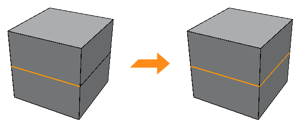

### Кольцо
**Клавиша:** Ctrl+Alt+клик

Выделяет кольцо рёбер или граней.

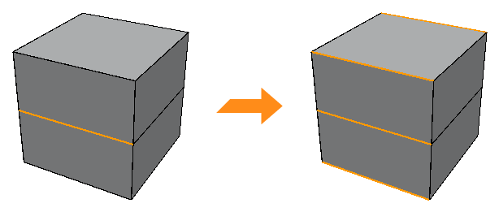

### Кратчайший путь
**Клавиши:** Ctrl+клик, Ctrl+Shift+клик

Ctrl+клик выделяет элементы между выделенным и кликнутым. 

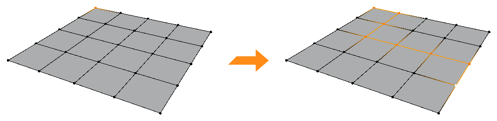

Ctrl+Shift+клик выделяет все кратчайшие пути между ними:
на сетке это весь прямоугольник.

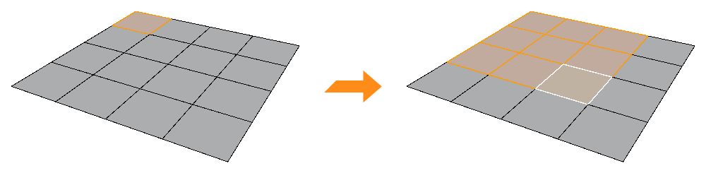

### Всё / Ничего / Инвертировать
**Клавиши:** A / Alt+A / Ctrl+I

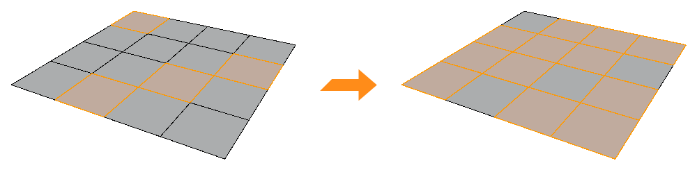

### Расширить / Сузить
**Клавиши:** Ctrl+= / Ctrl+-

Добавляет к выделению соседние элементы или убирает крайние.

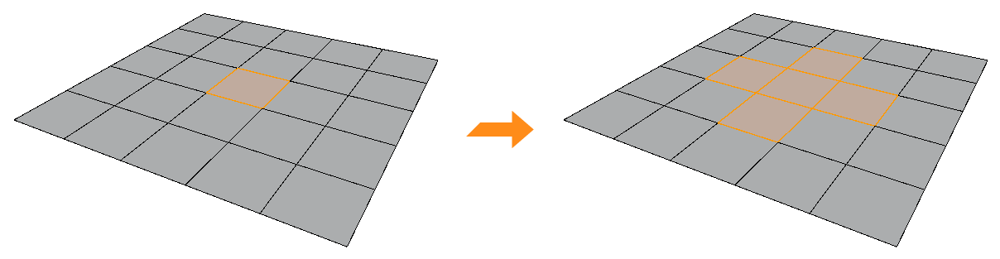

### Связанное
**Клавиши:** L / Ctrl+L

L выделяет связанную часть под курсором, Ctrl+L - связанную с выделенным.

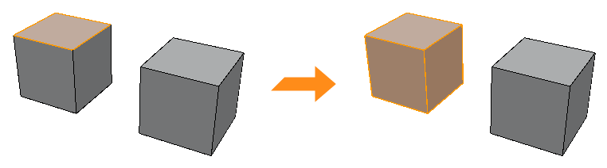

### Граница

Выделяет открытые края меша: рёбра, у которых только одна грань.

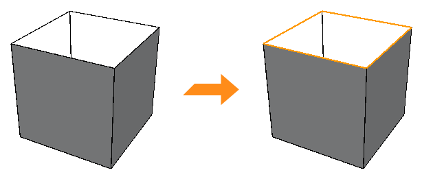

### Шахматное снятие выделения

Снимает выделение с каждого второго элемента.

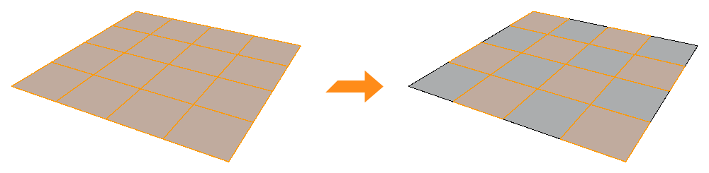

### Тот же материал

Выделяет грани с тем же материалом.

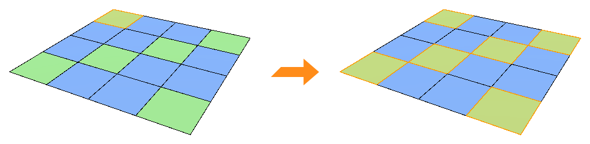

### Та же нормаль

Выделяет грани с тем же направлением.

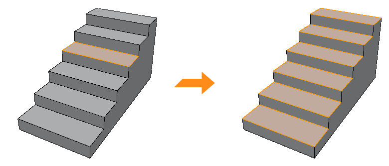

### Неверные UV

Выделяет грани, у которых UV не имеют площади.

### Внутренние грани

Выделяет грани, которых не видно: внутри собственного объёма меша (слитые объекты, которые пересекаются или касаются).

### Скрыть / Показать
**Клавиши:** H / Shift+H / Alt+H

Скрывает выделенные грани, остальные грани или показывает всё снова. Скрытые грани не видны только в режиме
редактирования.

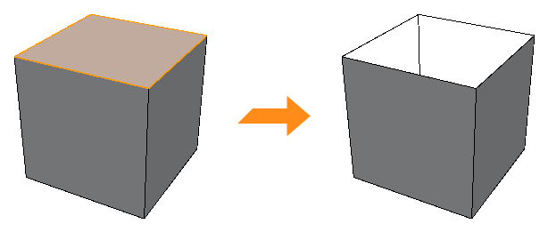

### Видимое выделение

Кнопка с глазом на верхней панели. Когда она включена, клики проходят сквозь грани, повёрнутые к камере изнанкой, и
комнату можно править снаружи.

Включено:

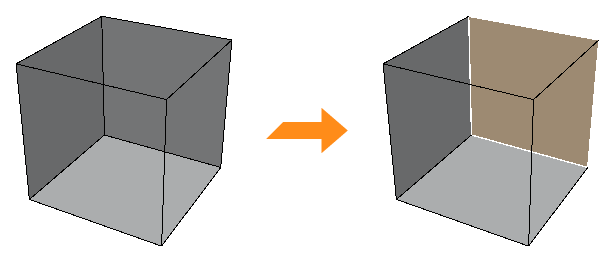

Выключено:

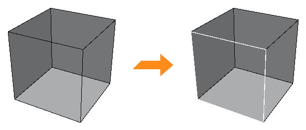

### Рентген
**Клавиша:** Alt+Z

Выделение проходит сквозь меш.

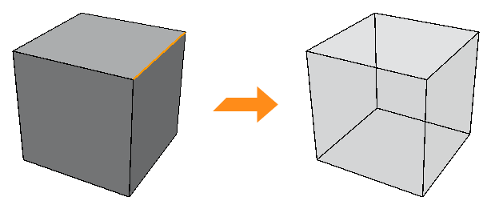

## Перемещение, вращение, масштаб

### Переместить / Повернуть / Масштабировать
**Клавиши:** G / R / S

Работает с выделенными элементами в режиме редактирования и с выделенными объектами в режиме объектов.

- X / Y / Z - ось, Shift+X / Y / Z - плоскость, второе нажатие - локальная ось.
- Значение перемещения можно ввести с клавиатуры.
- Ctrl - инвертирует привязку.
- Shift - замедляет изменение значения от движения мыши.
- ЛКМ или Enter - применить, ПКМ или Esc - отмена.

### Скольжение
**Клавиши:** G G

Выделенные элементы скользят вдоль рёбер. 
C - блокирует перемещение элементов на прямой текущего ребра.

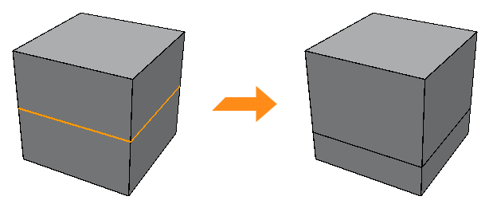

### Базовая точка
**Клавиша:** B (во время G / R / S и G G)

Клик - точка, откуда, второй клик - куда. Перемещает, поворачивает или масштабирует по этим точкам.

### Сдвиг стрелками
**Клавиши:** стрелки, Page Up / Page Down

Сдвигает выделение на шаг сетки по оси мира, ближайшей к виду. С Ctrl в режиме объектов сдвигается копия.

### Поворот стрелками
**Клавиши:** Alt+стрелки, Alt+Page Up / Page Down

Поворачивает выделение на 90°.

### Гизмо
**Клавиша:** W

Переключает гизмо: перемещение, поворот, масштаб, без гизмо.

### Ориентация
   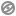   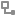

Меню на верхней панели: глобальная, локальная, нормаль, шарнир, вид, курсор, родитель. Пункт «Создать из выделения»
добавляет свою ориентацию по выделенному.

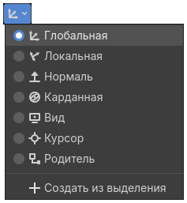

### Центр трансформаций
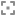    

Меню на верхней панели: центр габаритов, 3D-курсор, индивидуальные центры, средняя точка, активный элемент.

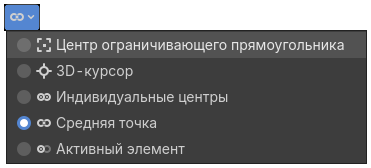

### Пропорциональное редактирование
\
**Клавиши:** O / Alt+O

Вместе с выделенным двигаются соседние элементы, тем меньше, чем дальше. Alt+O - только связанные. 

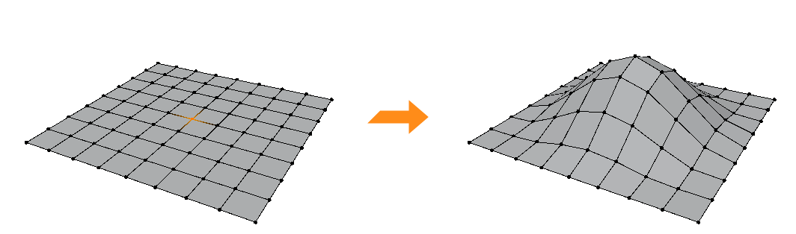

### Симметрия
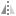

Кнопка на верхней панели, оси - в меню рядом. Когда двигаешь вершины, зеркальные им по другую сторону оси объекта
двигаются отражённо. Новые грани не отражаются: для этого есть HewnMirrorModifier.

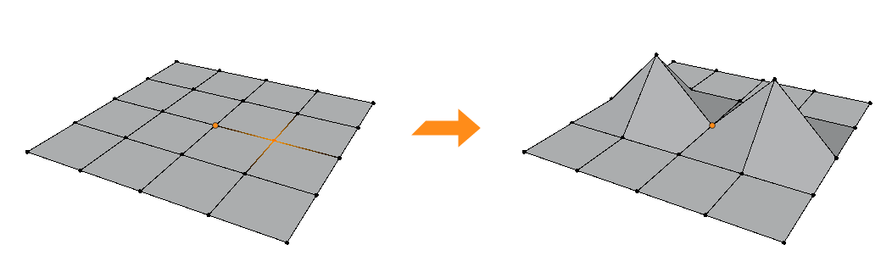

### Автослияние
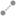

Кнопка на верхней панели. Вершины, оказавшиеся рядом после перемещения, сливаются.

## Привязка

### Привязка
**Клавиши:** Y, Shift+Tab

Включается магнитом Godot. В меню привязки на верхней панели выбирается, к чему привязывать: шаг, сетка, вершина,
ребро, грань, центр ребра, центр грани.

### Шаг сетки
**Клавиши:** `[`, `]`

Делает шаг сетки вдвое меньше или больше. Текущий шаг виден рядом с меню привязки.

### 3D-курсор
\
**Клавиши:** Shift+ПКМ, Shift+S

Shift+ПКМ ставит 3D-курсор на поверхность. Shift+S - меню курсора: к выделенному, к началу координат, выделенное к
курсору.

## Вид

### Затенение
     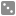 

Шейдер 3D-вида. «Растяжение UV» показывает, насколько растянута текстура: синий - нет, красный - сильно.


### Наложения
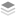

"Гладкие рёбра" - рёбра с гладким затенением фиолетовым.


## Вершины

Меню Меш -> Вершина.


### Выдавить вершины
**Клавиша:** E

Выдавливает вершины в новые рёбра.


### Фаска вершин
**Клавиша:** Ctrl+Shift+B

Срезает углы в выделенных вершинах.


### Толкать/Тянуть

Двигает вершины к центру выделения или от него.


### Сжать/Раздуть
**Клавиша:** Alt+S

Двигает вершины вдоль их нормалей.


### Скос

Скашивает выделение.


### Скольжение вершин
**Клавиша:** Shift+V

Двигает вершину вдоль одного из её рёбер.


### Случайно

Сдвигает вершины на случайное расстояние.


### Отразить

Отражает выделенное по оси.

### В окружность

Ставит выделенные вершины на окружность.


### Соединить
**Клавиша:** J

Соединяет выделенные вершины рёбрами через грани.


### Разорвать
**Клавиша:** V

Отрывает выделенное со стороны курсора и двигает.


### Объединить
**Клавиша:** M

Сливает выделенные вершины: в центр, в курсор, к первой, к последней, по расстоянию.


### Опустить / поднять до поверхности

Каждая выделенная вершина опускается (поднимается) по Y до ближайшей грани под ней (над ней).


### Объединить по расстоянию

Сливает вершины, стоящие ближе заданного расстояния.

### Складка вершины

Вершина остаётся острой при подразделении.

### Разделить
**Клавиша:** P

Переносит выделенное в новый меш. Можно разделить и по материалу или по несвязанным частям.

### Растворить вершины
**Клавиша:** Ctrl+X

Убирает вершины, соседние грани сливаются.


### Удалить вершины
**Клавиши:** X, Delete

Удаляет вершины и грани у них.


## Рёбра

Меню Меш -> Ребро.


### Выдавить рёбра
**Клавиша:** E

Выдавливает рёбра в новые грани.


### Фаска рёбер
**Клавиша:** Ctrl+B

Срезает рёбра. Колесо или +/- меняет число сегментов.


### Мост между петлями рёбер

Соединяет две петли рёбер гранями. С несколькими сегментами на концах видны рычаги, их можно тянуть.


### Протяжка по рёбрам

Протяжка (карниз) вдоль выделенных рёбер, снаружи граней рядом с ними. В режиме граней - по краю выделенных граней.


### Стена по рёбрам

Стена на выделенных рёбрах: парапет, ограда. Высота, толщина и сторона потом в панели фигуры.


### Новая грань из рёбер
**Клавиша:** F

Создаёт грань по выделенным рёбрам или вершинам. Две вершины - ребро между ними.


### Подразделить

Делит выделенные рёбра.


### Петлевой разрез и сдвиг
\
**Клавиша:** Ctrl+R

Режет петлю граней. Колесо - число разрезов, клик - разрез, потом мышью сдвиг, клик - применить.


### Скольжение со смещением
**Клавиша:** Ctrl+Shift+R

Добавляет рёбра по обе стороны выделенных и двигает их от середины.


### Соединить

Соединяет середины выделенных рёбер.


### Вставить петлю

Вставляет петлю через выделенное ребро.


### Арка из рёбер

Выгибает выделенные рёбра дугой. Два противоположных ребра потолка прохода дают свод.


### Повернуть ребро

Поворачивает ребро между двумя гранями.


### Вес фаски / Складка
**Клавиша:** Shift+E (складка)

Ребро со складкой остаётся острым при подразделении.

### Пометить шов / Убрать шов

Шов останавливает развёртку UV и продолжение текстуры.

### Пометить острым / Убрать остроту / Острота по углу

На остром ребре нормали гладких граней разделяются.

### Разъединить

Разрывает меш по выделенным рёбрам.

### Растворить рёбра
**Клавиша:** Ctrl+X

Убирает рёбра, грани по обе стороны сливаются.


### Удалить рёбра / Удалить петли рёбер


## Грани

Меню Меш -> Грань.


### Выдавить грани
**Клавиша:** E

Выдавливает грани вместе. Alt+E - меню других вариантов.


### Выдавить вдоль нормалей

Каждая вершина уходит по своей нормали.


### Выдавить по отдельности

Каждая грань выдавливается сама по себе.


### Выдавить с повтором

Выдавливает выделение несколько раз подряд.


### Вставка
**Клавиша:** I

Создаёт внутри граней грани поменьше.


### Прокрутить


Вращает копии выделенного шагами вокруг 3D-курсора.


### Ткнуть

Делит грань на треугольники с вершиной в центре.


### Мост между гранями

Соединяет две грани туннелем, сами грани удаляются.


### В окружность

Ставит край выделенных граней на окружность.

### Подразделить

Делит грани.


### Триангулировать

Делит грани на треугольники.


### Треугольники в четырёхугольники

Сливает пары треугольников.


### Объединить грани

Сливает выделенные грани в одну, рёбра между ними убираются.


### Толщина

Выделенные грани становятся телом с толщиной.


### Заполнить отверстие

Закрывает дыру гранью.


### Гладкое затенение / Плоское затенение


### Отразить нормали

Разворачивает грани.


### Двусторонний

Делает выделенные грани видимыми с обеих сторон: лист, забор. Повторно - снова с одной.


### Пересчитать наружу / внутрь
**Клавиши:** Shift+N / Ctrl+Shift+N

Разворачивает все грани наружу или внутрь. Alt+N - меню нормалей.


### Отделить

Отрывает выделенные грани от соседних, они остаются в том же меше.


### Дублировать
**Клавиша:** Shift+D

Копирует выделенное и двигает копию.


### Растворить грани / Растворить по ограничению

Сливает грани. По ограничению - только те, что сходятся под малым углом.


### Удалить грани


### Перетаскивание грани
**Клавиша:** Shift+перетаскивание

В режиме объектов двигает грань вдоль её нормали, соседние грани тянутся. Ctrl+Shift+перетаскивание наружу
выдавливает новый блок, внутрь - отрезает часть объекта.

### Резак граней


Режет грань линиями от одного из её рёбер.

## Инструменты

Панель инструментов слева во вьюпорте.


### Выделение рамкой
  


### Линейка
\
**Клавиша:** Shift+M

Протяжка - новая линейка. Тянуть середину - угол. X или Delete над линейкой - удалить.


### Нож
\
**Клавиша:** K


Клики ставят точки, Enter режет. ПКМ заканчивает текущий разрез. A - шаг угла 30°, Ctrl - середина ребра.

### Петлевой разрез
\
**Клавиша:** Ctrl+R


### Вырезание рамкой


Прямоугольник, круг или многоугольник на грани: перетаскивание или щелчки по углам, затем глубина. X / K / J / I / M -
вырезать, разрезать, присоединить, пересечь, создать.

### Рассечь


В режиме редактирования: проведите линию через меш, плоскость через неё и взгляд режет выделенное. В панели: только
разрезать, разрезать и заполнить, удалить сверху или снизу.

### Отсечение
\
**Клавиша:** Alt+X


Клики ставят 2 или 3 точки, плоскость через них режет. Ctrl+Enter - что оставить, Enter - применить.

### Прокрутить


Кольцо вокруг 3D-курсора: тянуть его - выделение вращается вокруг оси. X / Y / Z / V - ось.

## Инструменты уровня

### Вырез коробкой / цилиндром / призмой
**Клавиша:** C (коробкой)

Рисуется как фигура и вырезает объём из мешей. Работает на редактируемом меше, на выделенных объектах или на всей
сцене.


«Рамка» в панели выреза: откосы проёма и рамка вокруг него.


### Меш-каттер

«В меш-каттер» в панели каттера: каттер становится мешем Hewn, который правится как обычный меш и вырезает себя из
мешей. Незамкнутый ничего не режет.

## Объекты

Меню Объект.

### Применить трансформацию

Переносит положение, вращение и масштаб в вершины.

### Центр к геометрии / к 3D-курсору / к выделению

Двигает центр объекта, геометрия остаётся на месте.

### Подразделить (Катмулл-Кларк)

Сглаживает меш подразделением.


### Ремеш

Вкладка «Объект» на панели Hewn. Строит выделенные замкнутые меши заново, форма сохраняется.
- «Воксель»: грани размером с воксель.


- «Квад»: четырёхугольники нужной плотности.


### Коллизия

Галочка Collision Only: в игре от объекта остаётся только коллизия (невидимая стена).

Группа «Коллизия» в инспекторе меша Hewn. Типы:
- Trimesh


- Convex


- Simplified Convex


- Multiple Convex


- Box


- Capsule


- Cylinder


- Sphere


- Simplified Trimesh


### Автосглаживание

Гладкое затенение с острыми рёбрами по углу.

### В четырёхугольники

Сливает треугольники всего меша в четырёхугольники.


### Согласовать нормали / Триангулировать всё / Отразить все нормали

### Применить модификаторы

Переносит результат модификаторов в сам меш. «Применить модификатор» в меню объекта - только один.

### Объединить выделенные объекты

**Клавиша:** Ctrl+J

### Удалить внутренние грани

Удаляет грани внутри тела после объединения пересекающихся объектов. Внутренность комнаты остаётся.

### Булево объединение / разность / пересечение
  

Объединение:


Разность:


Пересечение:


### MeshInstance3D -> Hewn

Переводит обычный меш (или CSG) в меш Hewn.

### Запечь в MeshInstance3D

Делает из выделенных мешей и кривых Hewn обычный MeshInstance3D.

### Экспорт OBJ / Экспорт glTF

Сохраняет выделенный меш в файл (glTF или FBX), персонажа - со скелетом и анимациями.

### Меню объекта
**Клавиша:** ПКМ

В режиме объектов: центр, курсор к выделенному, затенение, нормали, дублировать, удалить, очистить и применить
трансформацию.


### На пол / к потолку

Опускает (поднимает) выделенные объекты, пока не коснутся поверхности.


### Размещение физикой

Выделенные объекты падают на то, что вокруг. Их можно таскать мышью; Enter - оставить, Esc - отмена.

### Преобразовать в коллизию

Делает из выделенных мешей формы столкновений: выпуклые, Trimesh, куб, сфера, капсула, цилиндр.

### Удалить
**Клавиша:** X

В режиме объектов удаляет выделенные узлы.

### Изолировать / Навести камеру
\
**Клавиши:** / , .

## Модификаторы

Модификаторы добавляются в инспекторе, в массиве Modifiers (Add Element). Работают сверху вниз, порядок меняется
перетаскиванием.

### HewnMirrorModifier

Отражает меш по осям или по плоскостям другого узла.


### HewnSolidifyModifier

Придаёт мешу толщину.


### HewnSubdivisionModifier

Сглаживает меш подразделением.


### HewnBooleanModifier

Объединяет, вычитает или пересекает меш с другими объектами. Объекты остаются операндами, их можно двигать.


### HewnArrayModifier

Копии меша по линии, по кругу или вдоль кривой.


### HewnCurveModifier

Изгибает меш вдоль кривой.


### HewnRemeshModifier

Строит меш заново: кубиками, сглаженно, с острыми углами или четырёхугольниками.


### HewnFractureModifier

Разбивает объект на куски. В игре куски - один меш, отдельные меши или физические тела.


### HewnSimplifyModifier

Упрощает меш: убирает часть треугольников или объединяет грани, лежащие почти в одной плоскости.


## Текстуры

### Док «Текстуры»

Картинки проекта. Клик по картинке кладёт её на выделенные грани, в режиме объектов - на выделенные объекты. Картинку
можно перетащить на грань или объект.


### Перенос текстуры
**Клавиши:** Alt+клик, Ctrl+Alt+клик, Alt+ПКМ

Когда выделена одна грань, Alt+клик переносит её текстуру на другие грани, узор продолжается через рёбра. С
протягиванием - на все грани под курсором.
Ctrl+Alt+клик переносит только UV. Alt+ПКМ берёт текстуру с кликнутой грани.

### Текстура к ребру
**Клавиша:** T

Прижимает текстуру к ребру под курсором. W / A / S / D - какой стороной, Q - вписать по высоте, E - по ширине, R -
масштаб 1. Клик, Enter или T - применить, Esc - отмена.


### Трансформация текстуры
**Клавиша:** Shift+T

Показывает тайл текстуры на выбранной грани с ручками: углы и стороны - масштаб, центр - сдвиг, кружок - поворот.
G / R / S - то же мышью без ручек. Клик мимо ручек или Enter - применить, Esc - отмена.


### Инструменты текстуры
**Клавиша:** U

Меню под курсором с инструментами вкладки UV: двигать, вращать, масштабировать, отразить, вписать, по центру, кубическая
проекция, продолжить от активной грани.

### Мировые UV

Текстура берётся по положению грани в мире: соседние объекты стыкуются без швов. Включается во вкладке UV, «Применить
мировые UV» переводит выделенное. «Выровнять по грани» убирает растяжение на наклонных гранях.

### Хотспоты

Атлас (трим-шит) - материал, картинка которого разрезана на ячейки. Каждая грань получает подходящую ячейку: уровень
текстурируется без развёртки.

Вкладка «Хотспот» панели Hewn:


- «Новый атлас» / «Убрать» - атласы меша; из нескольких грань берёт подходящий.
- «Разложить хотспоты» - каждый раз другой вариант. «Авто-хотспот» - заново после каждой правки.
- «Объединить грани» - соседние грани с малым изгибом получают одну ячейку.
- «Выбрать хотспот» (режим правки) - ячейка для выделенных граней.

«Изменить атлас» - панель «Атлас хотспотов»:


- Щелчок режет картинку (Ctrl - одну ячейку), Shift+перетаскивание - новая ячейка, X - удалить.
- Ячейкам задаются вид граней (пол, потолок...), повторение, поворот, вес, размеры. «Радиальный» - для круглых граней.


### Развёртка
**Клавиша:** U

Меню U в режиме правки:
- «Пометить шов» / «Убрать шов», «Швы по углу»;
- «Развернуть», «Умная проекция UV», проекции куба, цилиндра, сферы и из вида;
- «Ослабить растяжения».


#### Выпрямить в сетку

Лента четырёхугольников по выделенному ребру раскладывается ровной сеткой.


### Блокировка UV

Грани, которые двигают в режиме редактирования, уносят текстуру с собой.

### Вкладка «Материал»

Материалы меша и настройки текстуры выделенных граней: фильтрация, прозрачность, цвета вершин, шероховатость,
металличность.


### Скрыть повторы

Галочки "Шестиугольники", "Случайный поворот", "Вариация цвета" делают из материала шейдерный материал, в котором
повторы текстуры не выстраиваются в ряд.

### Служебные материалы

Материал «Отсечение» не рисуется в игре, но даёт коллизию. Им делают невидимые стены.

### UV2 для лайтмапов

Вкладка «Сцена». Строит вторую развёртку для запекания света.

## UV-редактор

Док «Hewn UV»: UV поверх текстуры. UV / UV2 - в заголовке.


- 1 / 2 / 3 - вершины, рёбра, грани; клик, Shift, рамка - выделение; L - остров.
- G / R / S или перетаскивание, X / Y - ось.
- H / Shift+H / Alt+H - скрыть, скрыть остальное, показать.
- U - развёртки и выравнивание, Ctrl+P - упаковать.
- Первая кнопка - выделение общее с вьюпортом.

## Скульптинг


Режим выбирается в меню в начале верхней панели. ЛКМ - мазок, Ctrl - в другую сторону, Shift - сглаживание.
Ctrl+колесо или [ / ] - радиус, Shift+колесо - сила. Если что-то выделено, лепится только выделенное.

Инструменты в колонке слева: поднять / опустить, сгладить, выровнять, тянуть, шум, ступени, сжать, раздуть, резкий
край, плотность.

### Динамическая топология


Галочка на панели. Под кистью поверхность делится на треугольники нужного размера.

## Раскраска вершин


Режим выбирается в меню в начале верхней панели. Красятся вершины, рёбра или грани (1 / 2 / 3), а если что-то
выделено - только выделенное.

### Кисть


ЛКМ рисует. Ctrl+колесо - радиус, Shift+колесо - сила, Ctrl+клик - взять цвет.

### Карандаш


Красит одну вершину.

### Заливка


Красит выделенное или связанную часть.

### Выделить по цвету

«Цвета» -> «Выделить по цвету...»: вершины с цветом (или CUSTOM0-3) в пределах порога.

### Пипетка


Берёт цвет. С Shift - во второй цвет.

### Нормали


ЛКМ делает нормали гладкими, Ctrl+ЛКМ - плоскими.

### Цвета
**Клавиши:** X, D


X меняет местами два цвета, D сбрасывает их на чёрный и белый.

### Запечь свет

Меню «Цвета» или Объект -> «Запечь свет в цвета вершин». Записывает в цвета вершин свет и тени от источников
сцены.

### Материал смешивания

Вкладка «Материал». Смешивает до четырёх текстур по цвету вершин. Маска шума делает границы рваными, подъём по
закраске поднимает вершины (снег).

### Прокручивающийся материал

Вкладка «Материал»: текстура движется по граням (вода, конвейер).

## Рисование текстур


Меню в начале панели, Tab - выход. Рисует на альбедо (UV1) или на слое Detail (UV1 или UV2). Если картинки нет, первый
мазок создаёт PNG рядом со сценой.

ЛКМ - рисовать, Ctrl+колесо - радиус, Shift+колесо - сила, Ctrl+клик - пипетка, X - поменять цвета.

### Кисть и ластик
 \
**Клавиши:** B / E

Ластик стирает слой Detail, альбедо возвращает к исходному.

### Размытие, заливка, пипетка
  

Заливка - остров UV под щелчком.

### Перо и отпечаток

- Перо: нажим, наклон и скорость меняют размер и силу.
- Отпечаток: картинка как кончик кисти.

### Трафарет


Картинка поверх вида переносится на меш под кистью. Alt+перетаскивание - двигать, Alt+Shift - масштаб, Alt+Ctrl -
поворот.

## Режим позы


Tab на скелете или персонаже, Tab - выход.
- Клик, Shift+клик, рамка - выделение; [ / ] - родитель / дети; H / Alt+H - скрыть / показать.
- G / R / S - как с объектами; Alt+G / Alt+R / Alt+S - к позе покоя.
- Ctrl+C / Ctrl+V - копировать / вставить позу, Ctrl+Shift+V - зеркально.

### Зеркало по X и авто-IK
 

- Зеркало по X: кость другой стороны (.L / .R) повторяет зеркально.
- Авто-IK: G на кости поворачивает её родителей.

### Ключи
 \
**Клавиши:** I, Alt+I

Ключи выделенных костей в анимацию, открытую на панели «Анимация». Автоключи - на каждое изменение.

### Луковая кожа


Кости в соседних ключах: до - красные, после - синие.

### Ограничения

Меню «Поза»:
- «Добавить IK (две кости)» - на кисть или стопу, цепочку двигают маркеры Target и Pole;
- «Добавить «Смотреть на»» - кость смотрит на маркер Target;
- «Убрать ограничения».

### Библиотека поз

Меню «Поза»: сохранить позу под именем, применить, удалить.

## Риггинг


Меню в начале панели при выделенном скелете, Ctrl+Tab - режим позы. Новый скелет: Shift+A -> Скелет (одна кость,
человек, четвероногое).
- Точки - головы и хвосты костей; клик, Shift, рамка - выделение; G / R / S - двигать.
- E - выдавить, Shift+D - дублировать, X - удалить, Ctrl+P / Alt+P - родитель, F2 - имя, Ctrl+R - крен.
- «Симметрия» - кости другой стороны.

### Привязка


«Объект» -> «Привязать к скелету» при выделенных мешах Hewn и скелете: автоматические веса, ближайшая кость или пустые.

## Рисование весов


Меню в начале панели при привязанном меше, Tab - выход. Цвет - вес выбранной кости: синий - 0, красный - 1. Кость - на
панели или Ctrl+клик.
- Рисование, Прибавить, Вычесть, Сгладить, Образец.
- Меню «Веса»: нормализовать, очистить, отразить, автоматические веса заново.

## Сцены и объекты

### Док «Сцены»

Клик по сцене - сцена следует за курсором, отпускание ставит её. Q / E - поворот на 90°, N - по нормали поверхности,
R - случайный поворот. ПКМ по сцене - добавить в избранное.

### Сущности

Вкладка «Создание». Свет, прожектор, звук и свои объекты из `res://hewn_entities.json`.

### Декали и оверлеи

Картинка на поверхности. Декаль - узел Decal Godot, оверлей ложится на грани Hewn. - / = при размещении меняют размер.
Углы оверлея можно тянуть мышью, картинка искажается за ними.


### Изображение-референс

Shift+A -> Изображение. Картинка для обрисовки, в игре не видна.

### Рассеивание
  

Shift+A -> Рассеивание. Копии мешей или сцен, нарисованные на поверхностях: трава, камни, кусты. Меши и настройки - в
инспекторе и нижней панели. Пока узел выделен, его кисти в колонке инструментов:
- Кисть: добавляет копии. Ctrl - стереть, Shift - проредить.
- Ctrl+колесо или [ / ] - радиус.


### Запекание уровня

Bake Level: окно настроек, затем файл. Настройки сохраняются в проекте и действуют и при экспорте игры: окклюдеры,
объединение мелких мешей, деление больших, LOD, дальность видимости.

Run Baked запускает уровень в том виде, как после экспорта. F5 - без запекания.

### Дороги и мосты

Shift+A -> Кривая -> Дорога (оверлей или меш на земле) или Мост. То же включается у любой кривой: раздел Road в
инспекторе. Текстура - кликом по ней при выделенной кривой. Оверлей ложится на поверхность под кривой, меш идёт по
кривой. У моста сразу бордюры, коллизия и опоры.


### Кривые


Shift+A -> Кривая: Безье, окружность, NURBS, Path3D, верёвка. Кривая Hewn - это Path3D из нескольких сплайнов, с
радиусом и наклоном в точках. В инспекторе: выдавливание, фаска, заполнение, материал, коллизия.

Кривая рисуется кликами по точкам, как стена. Стены, протяжки и лестницы по пути следуют за своей кривой.

Tab - правка точек:
- клик / Shift / рамка - выделение, G / R / S;
- E - выдавить, F - соединить концы, Ctrl+клик - новая точка, X - удалить;
- V - тип ручки, Alt+C - замкнуть, Alt+S - радиус, Ctrl+T - наклон;
- ПКМ - меню: подразделить, рисовать, сгладить, упростить и другое.

«Размещения» (инспектор): меши вдоль кривой - заборы, столбы, фонари.

«Покраска вершин» (инспектор): меши под кривой окрашиваются - дорожка с материалом смешивания.

### Здание

Shift+A -> Кривая -> Здание: прямоугольник двумя кликами по углам. Здание (HewnBuilding3D) строится по кривой контура:
пол, стены, окна и крыша следуют за её точками.

Этажи - список в инспекторе (снизу вверх), у каждого:
- высота стен, толщина пола и стен, есть ли пол, стены, окна;
- окна: ширина, высота, подоконник, шаг, стороны без окон;
- свой контур (кривая под зданием; пусто - контур этажа ниже).

Там же крыша, карниз, цоколь, окна в щипцах и материалы.

ПКМ по зданию -> "Здание":
- "Добавить этаж" (копия верхнего), "Убрать верхний этаж".
- "Свой контур верхнего этажа": этаж другой формы.
- "Добавить внутренний двор": вырезается из здания, вдоль него встают стены.

Tab по контуру, выделить две соседние точки, ПКМ -> "Сторона здания":
- "Крыша: щипец / скат / по стилю".
- "Без окон" / "Окна" (этажи на этом контуре).
- "Добавить дверь": проём посередине стороны.

Окна расставляются по сторонам контура. Группа «Окна» здания: сцена или меш в проёмах и рамка.


### Верёвка

Shift+A -> Кривая -> Верёвка. 


### Запечь навмеш

Вкладка «Сцена» или меню «Объект»: NavigationMesh выделенных объектов (или всей сцены), сохраняется в файл.

### Заметка TODO

Shift+A -> Заметка TODO: заметка в месте уровня (что здесь планируется); её текст в панели. В игре её нет.


## Игра и экспорт

Вкладка «Сцена».

### Запечь уровень

Сохраняет копию сцены для игры: обычные MeshInstance3D, коллизия, окклюдеры. Эта сцена остаётся редактируемой.

### Экспорт сцены в glTF

Сохраняет всю сцену одним файлом (glTF или FBX).

### Проверить сцену

Список проблем сцены: грани без площади, несваренные вершины, неплоские грани и другие. Большую часть можно исправить
оттуда же.

### Размер сцены

Показывает, что занимает место в сохранённой сцене.

## Экран Quad

Вкладка рядом с 2D / 3D. Сверху слева 3D-вид, остальные - сверху, спереди и сбоку.


### Блок
**Клавиша:** Shift+B

Растяните коробку в 2D-виде, Enter создаёт фигуру.


### Отсечение
**Клавиша:** Shift+X

Проведите линию, Enter режет выделенные меши.

### Развернуть вид
**Клавиша:** Shift+Z

## Настройки

Редактор -> Настройки редактора -> Hewn.

- **Interface -> Hotkeys** - клавиши Hewn вкл / выкл.
- **Interface -> Last Operation Panel** - панель последней операции.
- **Interface -> Quad View** - экран Quad.
- **Interface -> Toggle On Color** - фон включённых кнопок в шапке и колонке инструментов.
- **Interface -> Wrap Cursor At Viewport Edges** - курсор при перетаскивании выходит с другой стороны вьюпорта.
- **MCP** - MCP-сервер (ниже).
- **Warnings -> Subdivide Face Limit** - сколько граней может добавить подразделение без вопроса.

Клавиши меняются в Редактор -> Настройки редактора -> Сочетания клавиш, раздел «hewn».

### MCP-сервер

Ассистент на этом компьютере (MCP-клиент) работает в сцене: узлы, фигуры и операции Hewn, текстуры, снимки вида,
запуск игры.

- **MCP -> Enabled** - включить (по умолчанию выключен). Адрес: `http://127.0.0.1:7777/mcp` (HTTP), его указывают в
  MCP-клиенте.
- **MCP -> Port** - порт.
- **MCP -> Token** - если задан, клиент должен прислать заголовок `Authorization: Bearer <токен>`.
- **MCP -> Allow Scripts** - разрешить запуск GDScript (по умолчанию нет).

Сервер слушает только этот компьютер и отказывает запросам со страниц сайтов. Каждое изменение - один шаг
Ctrl+Z.